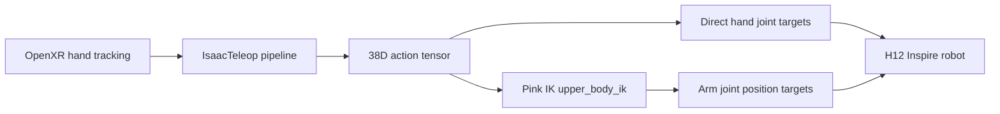

# H12 Inspire VR Teleoperation

This document summarizes how XR hand-tracking teleoperation was added for the Unitree H1-2 (H12) robot with Inspire hands in the RoboBenchMart darkstore fetching task.

## Goal

Enable OpenXR / CloudXR teleoperation for `H12InspireAnyItemEnvCfg`, following the same pattern already used for GR1T2 in `gr1t2_env_cfg.py` and Isaac Lab’s Unitree G1 Inspire pick-place example.

## Registered environment

| Gym ID | Config class |
|--------|----------------|
| `Dsynth-Fetch-Any-Item-H12-Inspire-v0` | `H12InspireAnyItemEnvCfg` |

Registration lives in `dsynth_isaac/tasks/manager_based/__init__.py`.

Primary implementation file: `dsynth_isaac/tasks/manager_based/unitree_env_cfg.py`.

## Architecture



1. **IsaacTeleop pipeline** (`_build_h12_inspire_pickplace_pipeline`) retargets XR hand data into a single 38-dimensional action vector.
2. **`PinkInverseKinematicsAction`** (`upper_body_ik`) solves IK for both wrists from the first 14 action dimensions.
3. **Hand joints** (last 24 dimensions) are applied directly as position targets, bypassing IK.

### Action layout (38D)

```
[left_wrist pose (7), right_wrist pose (7), hand joints (24)]
```

| Segment | Dims | Content |
|---------|------|---------|
| Left wrist | 7 | `pos_xyz` + `quat_xyzw` |
| Right wrist | 7 | `pos_xyz` + `quat_xyzw` |
| Hands | 24 | Inspire finger joints (`L_*` / `R_*`) |

Wrist poses are in **world frame**; Pink IK transforms them into the `pelvis` frame internally.

## Implementation details

### 1. IsaacTeleop retargeting pipeline

Function: `_build_h12_inspire_pickplace_pipeline()` in `unitree_env_cfg.py`.

Modeled on Isaac Lab’s `pickplace_unitree_g1_inspire_hand_env_cfg.py` (not GR1T2), because H12 uses the same Inspire hand kinematics (24 DOF) and Unitree arm naming as G1.

**Wrist tracking** — two `Se3AbsRetargeter` instances with Unitree Inspire frame offsets:

| Hand | Roll | Pitch | Yaw |
|------|------|-------|-----|
| Left | 0° | 90° | 0° |
| Right | 180° | −90° | 0° |

**Finger tracking** — two `DexHandRetargeter` instances using:

- YAML configs: `unitree_hand_left_dexpilot.yml`, `unitree_hand_right_dexpilot.yml`
- Hand URDFs from Isaac Lab Nucleus: `G1_inspire_assets/retarget_inspire_white_{left,right}_hand.urdf`
- `OPERATOR2MANO` transform: `[[0,-1,0],[-1,0,0],[0,0,-1]]`

**Output flattening** — `TensorReorderer` merges wrist poses and finger joints into the 38D tensor expected by `PinkInverseKinematicsActionCfg`.

### 2. Pink IK action config

Class: `H12InspireActionsCfg` → `upper_body_ik`

| Setting | Value |
|---------|-------|
| IK joints | Shoulders, elbows, wrists (14 total via regex) |
| Hand joints | 24 Inspire joints |
| EEF links | `left_wrist_yaw_link`, `right_wrist_yaw_link` |
| IK base link | `pelvis` |
| Frame tasks | Position cost 8.0, orientation cost 2.0 |
| Extra tasks | `DampingTaskCfg`, `NullSpacePostureTaskCfg` (shoulders only; no waist on H12) |

At runtime, the robot USD is converted to URDF in `H12InspireAnyItemEnvCfg.__post_init__` and passed to the Pink controller.

### 3. Teleop-tuned robot preset

Function: `_h12_inspire_teleop_robot_cfg()`

The stock `H12RobotPresets.h12_27dof_inspire_base_fix()` preset is not suitable for Pink IK teleop out of the box. A teleop-specific override was added:

| Change | Reason |
|--------|--------|
| `disable_gravity=True` | Matches G1 Inspire FTP; arms track IK without fighting gravity |
| Arm stiffness **3000**, damping **100** | Stock preset used 25–50; arms did not follow IK targets |
| Lock `torso_joint` (stiffness 10000) | Arms attach to `torso_link`; unactuated torso breaks IK chain |
| Elbow init **+1.0 rad** | Bent-arm start pose within H12 joint limits |

**Important:** H12 elbow limits are `[-0.95, 3.18]` with **positive** bend. GR1T2-style negative elbow angles (e.g. −1.57) are invalid and will fail env creation.

### 4. Environment wiring

Class: `H12InspireAnyItemEnvCfg`

| Field | Purpose |
|-------|---------|
| `xr: XrCfg` | XR anchor position / rotation in the sim world |
| `idle_action` | 38D hold pose when teleop is inactive |
| `isaac_teleop: IsaacTeleopCfg` | Connects pipeline builder to the teleop device |
| `temp_urdf_dir` | Output directory for USD→URDF conversion |

XR anchor defaults (same as GR1T2 darkstore config):

```python
xr: XrCfg = XrCfg(
    anchor_pos=(4.0, 5.0, 0.0),
    anchor_rot=(0, 0, 1, 0),
)
```

Robot base pose on reset: `[0, 0, 1.03]` via `H12InspireEventCfg`.

## How to run

### Teleoperation (recommended)

Use `scripts/teleop_se3_agent_beta.py` (auto-detects `isaac_teleop` from env config):

```bash
python scripts/teleop_se3_agent_beta.py \
  --task Dsynth-Fetch-Any-Item-H12-Inspire-v0 \
  --viz kit
```

Requires Pinocchio for Pink IK (`--enable_pinocchio` if your launcher does not set it automatically).

Press **START** in the XR client to activate teleop (default is inactive until started).

### Smoke test (no XR)

```bash
python scripts/demo_random_actions.py \
  --task Dsynth-Fetch-Any-Item-H12-Inspire-v0 \
  --config_dir_path generated_envs/isaac_sample \
  --num_envs 1
```

## Reference implementations

| Source | Used for |
|--------|----------|
| `dsynth_isaac/tasks/manager_based/gr1t2_env_cfg.py` | Darkstore env structure, `IsaacTeleopCfg` wiring, XR anchor |
| Isaac Lab `pickplace_unitree_g1_inspire_hand_env_cfg.py` | Inspire pipeline, Pink IK action layout, wrist frame offsets |
| Isaac Lab `pickplace_gr1t2_env_cfg.py` | Pink IK task structure (`DampingTaskCfg`, `FrameTaskCfg`) |

## Troubleshooting

### Fingers move, arms do not

**Cause:** Fingers use direct high-stiffness joint control; arms depend on Pink IK with much lower stock actuator gains and gravity enabled.

**Fix:** Use `_h12_inspire_teleop_robot_cfg()` (high arm stiffness, gravity off, locked torso).

### Joint limit error on startup

```
'left_elbow_joint': -1.571 not in [-0.950, 3.180]
```

**Cause:** GR1T2/G1 use negative elbow bend; H12 bends in the positive direction.

**Fix:** Use positive elbow init (currently `+1.0` rad).

### IK solver warnings

`show_ik_warnings=True` is enabled on the Pink controller. If wrists still do not track, check the console for `IK quadratic solver could not find a solution` and tune:

- `xr.anchor_pos` / `xr.anchor_rot`
- SE3 `target_offset_*` in `_build_h12_inspire_pickplace_pipeline()`
- `idle_action` wrist poses

## Tuning knobs

| Parameter | Location | Effect |
|-----------|----------|--------|
| `xr.anchor_pos`, `xr.anchor_rot` | `H12InspireAnyItemEnvCfg` | User-to-robot spatial alignment |
| `target_offset_roll/pitch/yaw` | `_build_h12_inspire_pickplace_pipeline` | Wrist orientation mapping |
| `FrameTaskCfg` costs / `gain` | `H12InspireActionsCfg` | IK tracking aggressiveness |
| `init_robot_base_pose` | `H12InspireEventCfg` | Robot spawn height / position |
| Arm `stiffness` / `damping` | `_h12_inspire_teleop_robot_cfg` | How tightly arms follow IK |
