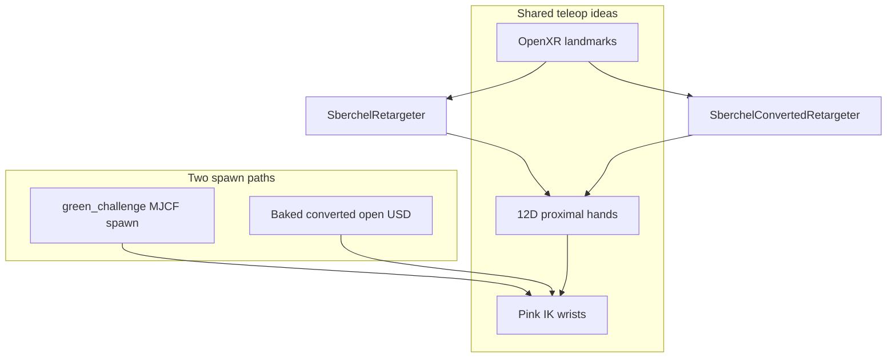

# Sberchel Converted Open-USD XR Teleop — Path to Success

This report documents the **converted open-USD upperbody** OpenXR teleop path that reached usable finger and thumb tracking for grasping. It answers the engineering questions that came up after the working attempt, and records what was taken from VisionRobotDemo (VRD), what was not, and how that relates to DexPilot and the green_challenge MJCF robot.

**Working task:** `Dsynth-Fetch-Any-Item-Sberchel-Converted-Upperbody-XR-v0`  
**Primary retargeter:** `dsynth_isaac/devices/sberchel_converted_retargeter.py`  
**Compare / debug script:** `scripts/teleop_sberchel_xr_compare.py`

Related ops doc: [sberchel_xr_teleop.md](sberchel_xr_teleop.md).

---

## 1. Goal and outcome

**Goal:** Upper-body teleop from OpenXR hand tracking — Pink IK for wrists, proximal finger joints for grasp — on Sberchel in the RoboBenchMart darkstore scene, without breaking the existing MJCF XR path.

**Outcome (converted path):**

- Wrists / arms track via Pink IK with OpenXR → `hand_base_link` frame offsets.
- Index / middle / ring / pinky curls track the operator’s fingers.
- Thumb pitch (flexion) tracks curl; thumb yaw (opposition / sideways) tracks palm-plane motion with enough range for wide grasps (e.g. bottle body, not only the neck).
- Digits no longer swap (index↔pinky, etc.) after packing order was aligned with Pink.

---

## 2. Direct answers

### 2.1 What fixed the fingers — indexing mismatch, or something else?

**Both indexing and thumb-yaw geometry. Not one alone.**

| Issue | Symptom | Fix |
|-------|---------|-----|
| **Hand action packing vs Pink order** | Digits swapped (wrong finger moves) | Pack the 12D hand action in **articulation DOF order** via `CONVERTED_SBERCHEL_HAND_JOINT_NAMES` in `sberchel_converted_env_cfg.py`. Pink’s `find_joints(..., preserve_order=False)` applies targets in robot joint order. On converted-open USD that order is: L_yaw, L_index…L_pinky, R_yaw, R_index…R_pinky, **then** L/R thumb pitch. Using the MJCF list (`SBERCHEL_HAND_JOINT_NAMES`, pitch right after yaw) caused the mismatch. Asserted in `teleop_sberchel_xr_compare.py`. |
| **Thumb yaw / opposition mapping** | Yaw stuck, reversed L/R, deadzone, or could not reach full side pose | Palm-plane **angle** map in `sberchel_converted_retargeter.py`: `angle = atan2(signed, fwd)`, linear map **−50° → 12°** into yaw `[-0.1, 1.3]`. OpenXR rest sits ~−35°…−45°; maps that treated `signed ≤ 0` as “fully open” created a large deadzone and felt like an angle shift. |
| **Digit curl (non-thumb)** | Needed a curl → proximal map | Converted path uses **VRD-style total curl** (see §4). Digits were largely correct once packing order was fixed. |

**Summary:** Indexing mismatch was the root cause of **digit swap**. Thumb sideways grasp needed a **separate OpenXR geometry calibration**. Arms/wrists were already on Pink + quaternion offset `(0.5, 0.5, 0.5, 0.5)` wxyz.

### 2.2 Were VRD curls necessary? Can we use DexPilot instead?

**VRD curls were not required for success.** They were an implementation choice on the converted path.

There are three finger strategies in this repo’s history:

| Approach | Where | What it does |
|----------|--------|----------------|
| **Joint-to-joint OpenXR flexion** | MJCF `SberchelRetargeter` (current) | MCP / thumb bone angles → proximal joint radians; thumb opposition via palm-plane signed remap |
| **VisionRobotDemo curls** | Converted `SberchelConvertedRetargeter` (current) | Multi-segment curl ∈ [0,1] × closeFraction → proximal span; thumb yaw via calibrated **−50°…12°** angle map |
| **DexPilot** (`dex_retargeting`) | GR1T2 path; Sberchel **legacy** assets only | Optimizer maps hand keypoints → robot hand joints via hand URDF + YAML |

**DexPilot for Sberchel:** possible in principle (same stack as GR1T2). Hand-tuned assets still exist via `dsynth_isaac/devices/sberchel_hand_urdf.py` and `dsynth_isaac/assets/sberchel_xr`, but:

- Current MJCF and converted retargeters **do not call DexPilot** (`dex_cache_dir` on those configs is unused).
- Docs mark DexPilot as **legacy**: auto-exporting finger chains from the full robot URDF produced tip frames that drove DexPilot to joint limits (permanently clenched hands). Hand URDFs must start at `*_hand_base_link`.
- Re-enabling DexPilot would still need correct **12D packing** into Pink, and thumb CMC (yaw) often needs extra care beyond stock DexPilot configs.
- Switching converted teleop to DexPilot is a **re-integration project**, not what unlocked the recent digit/thumb fixes.

**Practical stance:** Keep analytic retargeting (joint-to-joint or VRD curls + angle yaw). Treat DexPilot as optional future work if optimizer-based fingertip matching like GR1T2 is desired.

### 2.3 Was converted / baked USD required?

**No — not required in principle.** The same class of teleop already exists for green_challenge MJCF:

- Tasks: `Dsynth-Fetch-Any-Item-Sberchel-XR-v0` / `…-Upperbody-XR-v0`
- Retargeter: `sberchel_retargeter.py`
- Pink still needs a **tree URDF**, produced by the MJCF→USD→URDF cache in `sberchel_mjcf_usd.py` — that is an export step for IK, not a permanently baked “converted robot” product.

**Why the converted-open USD path was useful (engineering choice):**

- Open kinematics (serial wrists) avoid closed crank/rod loops fighting Pink.
- Fixed-pelvis spawn simplifies upperbody-only teleop.
- Separate retargeter (VRD curls + calibrated angle yaw) without risking the MJCF teleop path.
- Articulation finger DOF order differs from the MJCF name list — fixed locally with `CONVERTED_SBERCHEL_HAND_JOINT_NAMES`.

You can port the successful thumb-angle map (and packing-order discipline) back to the MJCF upperbody task without keeping a baked converted asset; Pink’s export pipeline is still required for IK.



---

## 3. Architecture (converted upperbody path)

### 3.1 Action layout (26D)

```
[left_wrist (7) | right_wrist (7) | hand joints (12)]
```

- Wrists: absolute OpenXR wrist pose × static `hand_base` offset → Pink EEF targets (`left_hand_base_link` / `right_hand_base_link`).
- Hands: 12 proximal masters only (mimic intermediate/distal follow MJCF/USD constraints — do not command slaves with PD).

### 3.2 Converted hand packing order (must match Pink)

```text
left_thumb_proximal_yaw_joint
left_index_proximal_joint
left_middle_proximal_joint
left_ring_proximal_joint
left_pinky_proximal_joint
right_thumb_proximal_yaw_joint
right_index_proximal_joint
right_middle_proximal_joint
right_ring_proximal_joint
right_pinky_proximal_joint
left_thumb_proximal_pitch_joint
right_thumb_proximal_pitch_joint
```

Defined as `CONVERTED_SBERCHEL_HAND_JOINT_NAMES`. **Do not** reuse MJCF `SBERCHEL_HAND_JOINT_NAMES` for this task.

### 3.3 Thumb joint roles

| Robot joint | Human cue | Mapping |
|-------------|-----------|---------|
| `*_thumb_proximal_pitch_joint` | Flexion / curl | VRD thumb curl × closeFraction → span `[0.0, 0.5]` |
| `*_thumb_proximal_yaw_joint` | Opposition / sideways in palm plane | Palm-plane angle **−50°…12°** → span `[-0.1, 1.3]` |

---

## 4. What was taken from VisionRobotDemo (VRD)

The converted retargeter deliberately reuses pieces of VisionRobotDemo’s hand pipeline (ported to OpenXR landmark names). This section lists **exactly** what came from VRD and what did not.

### 4.1 Taken from VRD (and used)

| VRD concept | Source (VRD) | In our code |
|-------------|--------------|-------------|
| **Digit curl** | `digitCurl` — sum of segment flexions along a finger, normalized to `[0,1]` with deadzone | `_digit_curl`, normalizers `2.6` / deadzone `0.05`, fallback normalizer `0.92` |
| **Thumb flexion curl** | `thumbFlexionCurl` (VRD has a thumb intermediate; OpenXR does not — we adapt bones) | `_thumb_flexion_curl`, normalizer `1.8` / deadzone `0.05`, fallback `1.04` |
| **Segment flexion** | Angle between consecutive bone vectors | `_segment_flexion` |
| **closeFraction at full curl** | `gVRDFingerJointMeta` / `closeFractionAtFullCurl` in `MuJoCoBridge.mm` | `_CLOSE_FRACTION` (index 1.45/1.70, middle 1.48/1.70, ring 1.43/1.70, pinky 1.36/1.70; thumb yaw/pitch 1.0) |
| **Open → closed joint span** | `open + fraction * (closed − open)` with closingSign=+1 | `_span_target` + `_DIGIT_PROXIMAL_LIMIT` / `_THUMB_*_LIMIT` |
| **Finger blend** | `VRDUpdateFingerTargets` blend toward new targets | `_FINGER_BLEND = 0.28` |
| **Thumb opposition geometry (idea)** | `thumbOpposition` — project thumb tip−knuckle into palm plane, lateral vs index−little | `_thumb_opposition` uses the same palm frame construction (`wrist`, metacarpals, in-plane thumb) |
| **little → pinky name map** | OpenXR / ARKit “little” finger | `_DIGIT_STEMS` maps `little` → `pinky` |

Constants are annotated in `sberchel_converted_retargeter.py` as coming from `ARKitTrackingManager.swift` and `MuJoCoBridge.mm`.

### 4.2 Adapted from VRD (changed for OpenXR / Sberchel)

| Topic | VRD / ARKit | Our adaptation |
|-------|-------------|----------------|
| Landmark set | ARKit hand skeleton | Isaac OpenXR `HAND_JOINT_NAMES` (`thumb_metacarpal`, `little_*`, etc.) |
| Thumb intermediate | Present in VRD | OpenXR has no thumb intermediate — flexion uses metacarpal→proximal→distal (and fallbacks) |
| Opposition → joint | VRD `clip(signed * gain, 0, 1)` style | **Calibrated angle map** −50°…12° (OpenXR rest and range differ from ARKit) |
| Wrist / arm | VRD MuJoCo / other stack | **Not from VRD** — Isaac absolute wrists + Pink IK + offset `(0.5,0.5,0.5,0.5)` |

### 4.3 Not taken from VRD

- Pink Inverse Kinematics / Pinocchio URDF pipeline
- Darkstore scene / RoboBenchMart env managers
- DexPilot / `dex_retargeting` optimizer
- GR1T2-specific DexPilot YAMLs
- Locomotion / zest legs (converted upperbody task is 26D only)
- MJCF joint-to-joint MCP radian mapping used by `SberchelRetargeter` (parallel design, not VRD)

### 4.4 Hybrid design of the successful attempt

Conceptually the working converted stack is:

1. **Wrists from the Isaac MJCF XR attempt** that already tracked well (absolute OpenXR + frame offset + Pink).
2. **Finger curls from VRD** (multi-segment curl → closeFraction → proximal span).
3. **Thumb yaw calibrated on OpenXR evidence** (angle span tuned against compare-script / debug logs), not a straight copy of VRD’s `clip(signed * gain)`.

That hybrid is why the module docstring describes “Isaac wrists + VisionRobotDemo finger curl.”

---

## 5. Chronological path to making it work

### 5.1 Foundations (before the final finger debug)

1. Pink IK on Sberchel required a tree URDF (MJCF→USD→URDF sanitize, or baked open USD).
2. Upperbody / open model preferred so wrist crank/rod equality constraints do not fight Pink.
3. Command **proximal masters only**; commanding mimic intermediate/distal with PD fought constraints and locked chains.
4. Wrist orientation offset derived offline (`derive_sberchel_openxr_wrist_offset.py`) → `(0.5, 0.5, 0.5, 0.5)` wxyz both sides.
5. Converted-open fixed-base env + `SberchelConvertedRetargeter` registered as an additive Gym task.

### 5.2 Digit swap (indexing)

1. Operator saw wrong digits moving while curls looked nonzero in logs.
2. Root cause: Pink applies the last 12 action dims in **articulation order**, not logical list order.
3. Converted USD places thumb **pitch after** digit proximals; MJCF list puts pitch next to yaw.
4. Fix: `CONVERTED_SBERCHEL_HAND_JOINT_NAMES` + compare-script assert that Pink’s resolved order matches packed names.
5. After this, non-thumb fingers tracked correctly.

### 5.3 Thumb yaw (geometry / range / deadzone)

1. **Stuck near −0.1:** VRD-style half-range clip zeroed the side of the lateral signal OpenXR actually used.
2. **Chirality flips / gain knobs:** Made one or both hands move, but polarity and saturation fought each other (“opposite directions,” always maxed, etc.).
3. **Bipolar `0.5*(signed+1)`:** Restored consistent direction for both hands (same idea as MJCF `SberchelRetargeter` opposition remap).
4. **Under-reach for grasp:** OpenXR `|signed|` rarely exceeded ~0.3; bipolar mid-rest left little travel to full yaw.
5. **Aggressive open-at-zero maps:** Full yaw became reachable but felt like a **jump after a large bend** — rest sat at negative signed/angle while the map ignored everything ≤ 0.
6. **Final map:** Continuous palm-plane angle from **−50° to 12°** → opposition ∈ [0,1] → yaw span. Small bends move the robot; full sideways still saturates for wide grasp.

Evidence for the deadzone: when opposition was ~0, measured angles often sat near **−33°…−46°** while the map only started at **−25°**; widening open to **−50°** removed that plateau.

### 5.4 Verification tooling

`scripts/teleop_sberchel_xr_compare.py` dumps:

- OpenXR landmark positions
- Robot finger/hand link poses
- `q` vs `q_des` for proximal joints
- Packed finger vector + names
- Thumb opposition / signed (when exposed)

Use it whenever packing or thumb mapping changes.

---

## 6. Key files

| Path | Role |
|------|------|
| `dsynth_isaac/tasks/manager_based/sberchel_converted_env_cfg.py` | Converted XR env; `CONVERTED_SBERCHEL_HAND_JOINT_NAMES`; Pink + device wiring |
| `dsynth_isaac/devices/sberchel_converted_retargeter.py` | OpenXR → wrists + VRD curls + angle thumb yaw |
| `dsynth_isaac/robots/sberchel_converted_cfg.py` | Baked open USD robot / fixed-base / teleop PD |
| `dsynth_isaac/tasks/manager_based/sberchel_base_env_cfg.py` | MJCF XR path; `SBERCHEL_HAND_JOINT_NAMES` (different order) |
| `dsynth_isaac/devices/sberchel_retargeter.py` | MJCF joint-to-joint fingers (no VRD total-curl) |
| `dsynth_isaac/devices/sberchel_hand_urdf.py` | Legacy DexPilot hand URDF/YAML helpers |
| `scripts/bake_sberchel_usd.py` | Bake open USD |
| `scripts/teleop_sberchel_xr_compare.py` | Landmark vs robot dumps + packing assert |
| `docs/sberchel_xr_teleop.md` | Runbook for MJCF + converted teleop |

---

## 7. Final contracts (do not break)

1. **Packing:** Converted Pink hand list must match articulation order (pitch last). Never mix in `SBERCHEL_HAND_JOINT_NAMES` for the converted task.
2. **Proximals only:** Action vector commands proximal masters; mimics follow.
3. **Thumb yaw:** Angle open/full defaults **−50° / 12°**; yaw joint limits **−0.1 / 1.3**.
4. **Thumb pitch:** VRD curl → **[0.0, 0.5]**.
5. **MJCF path remains independent:** Changes to `SberchelConvertedRetargeter` must not silently rewrite `SberchelRetargeter` unless intentionally porting (e.g. thumb-angle map).

---

## 8. How to run

Bake (once):

```bash
/home/soshin/miniconda3/envs/env_isaaclab/bin/python scripts/bake_sberchel_usd.py --open --headless
```

Teleop:

```bash
../IsaacLab/isaaclab.sh -p scripts/teleop_se3_agent.py \
  --task Dsynth-Fetch-Any-Item-Sberchel-Converted-Upperbody-XR-v0 \
  --teleop_device handtracking \
  --enable_pinocchio
```

Compare dumps:

```bash
../IsaacLab/isaaclab.sh -p scripts/teleop_sberchel_xr_compare.py \
  --task Dsynth-Fetch-Any-Item-Sberchel-Converted-Upperbody-XR-v0 \
  --teleop_device handtracking \
  --enable_pinocchio \
  --print_every_n 30 \
  --log_file /tmp/sberchel_xr_compare.log
```

Press **START** in XR after the sim is ready.

---

## 9. Optional follow-ups (not done in this report)

- Port the **−50°…12°** thumb-angle map into MJCF `SberchelRetargeter` for consistent grasp feel.
- Re-integrate DexPilot with hand-tuned URDFs if fingertip optimizer matching is required (packing order still mandatory).
- Further tune `_THUMB_ANGLE_OPEN_DEG` / `_THUMB_ANGLE_FULL_DEG` per headset / operator if rest pose differs.

---

## 10. One-line summary

**Success = correct Pink hand packing (indexing) + VRD-style digit/thumb curls + OpenXR-calibrated palm-plane thumb yaw; baked converted USD was convenient but not strictly required; DexPilot was not what made fingers work.**
