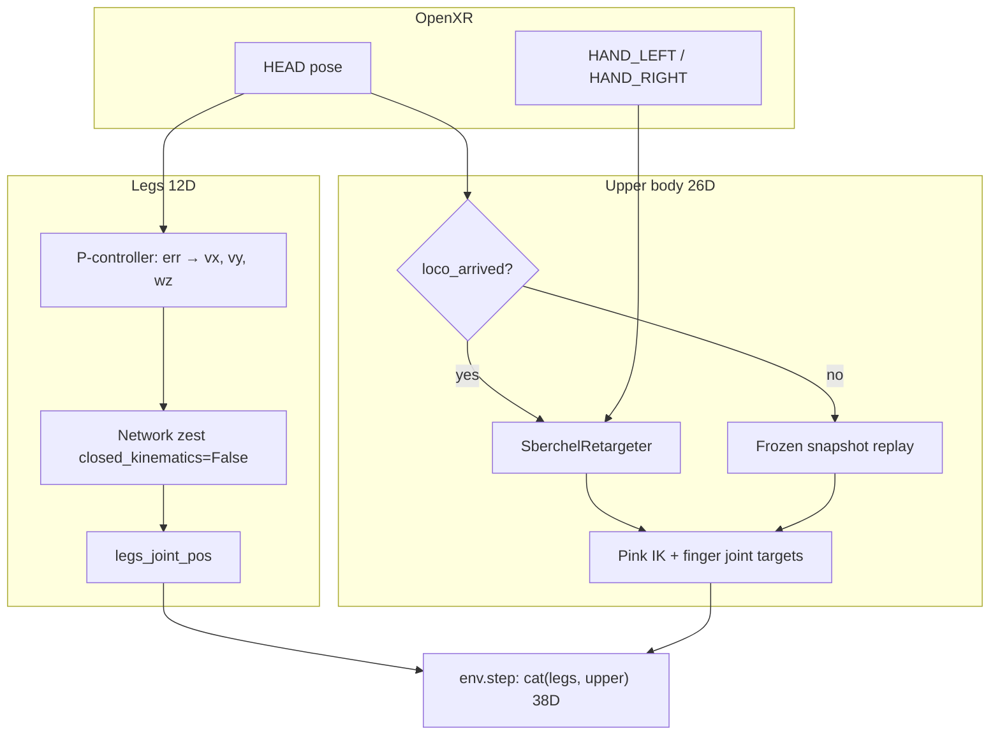
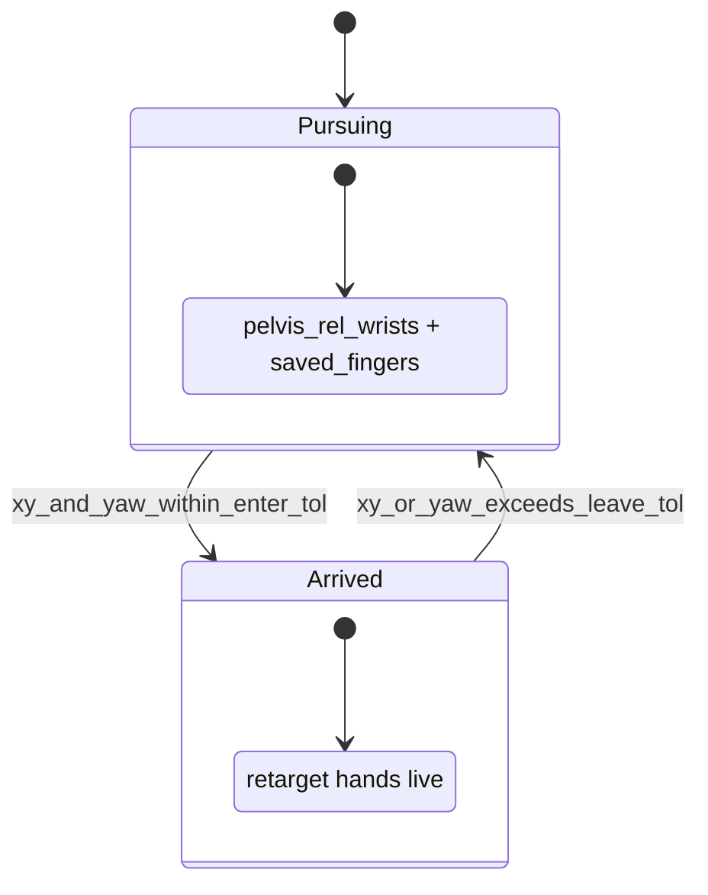

# Sberchel XR Teleop with Headset-Following Locomotion — Implementation Report

This report documents **headset-follow VR teleop** for free-floating Sberchel: the robot’s legs follow the OpenXR HMD in world XY and yaw via a P-controller feeding the green_challenge **zest** policy, while upper-body teleop is **arrival-gated** and **body-relative frozen** during pursuit so grasps survive walking.

**Scripts:**

| Script | Scene / task focus |
|--------|-------------------|
| `scripts/teleop_sberchel_head_follow.py` | Darkstore fetch (`Dsynth-Fetch-Any-Item-Sberchel-XR-v0`) or demo (`Isaac-Demo-Sberchel-XR-v0`) |
| `scripts/teleop_sberchel_demo_head_follow.py` | Same logic; demo-oriented defaults (no required `config_dir_path`) |

**Env configs:** `dsynth_isaac/tasks/manager_based/sberchel_xr_env_cfg.py`  
**Upper-body stack:** `dsynth_isaac/tasks/manager_based/sberchel_upperbody_xr_env_cfg.py`  
**Retargeter:** `dsynth_isaac/devices/sberchel_retargeter.py`

Builds on full-body XR locomotion in [`sberchel_xr_locomotion_teleop_report.md`](sberchel_xr_locomotion_teleop_report.md). That report covers `teleop_sberchel.py` (station-keep legs, always-on hand teleop). This report covers the **head-follow + arrival-gated** variant.

---

## 1. Goal and outcome

### Problem

With standard `teleop_sberchel.py`, the robot holds a fixed world pose while the user walks in VR. For warehouse-style use, the robot should **walk to the user’s headset** instead.

Additional constraints discovered in practice:

1. **Yaw:** Robot body +X is forward; OpenXR view direction is local **−Z**. Euler-Z on the HMD quaternion does not match “where you look.”
2. **Arms during walk:** Pink IK uses **absolute world** wrist targets. Driving hands from live XR while the base moves causes drift and dropped objects.
3. **Teleop timing:** Enabling hand teleop whenever `yaw_mode=headset` is too early — the user can be close in XY but misaligned in heading.
4. **Grasp freeze:** Freezing **measured** finger joints at pursuit start can open the hand vs the **commanded** grasp (PD lag under contact).

### Target behavior

| Phase | Legs | Upper body |
|-------|------|------------|
| Teleop inactive (before START) | Stand (policy with zero velocity command) | Idle from robot `hand_base_link` + zero fingers |
| **Pursuing** (active, not arrived) | P-control toward headset XY; long pursuit adds yaw; short pursuit is vx/vy only | **Frozen** pelvis-relative wrists + saved finger targets |
| **Arrived** (active, aligned) | Station-keep P-control to latched headset XY + view yaw (no position deadzone) | Live XR `retarget(raw)` → Pink IK |
| Walk away after grasp | Pursuing again | Freeze **last teleop command** (not robot state) |

### Outcome

- Headset XY + yaw following with hysteresis on distance and heading modes.
- `loco_arrived` gates XR hand teleop on **XY + yaw alignment**, independent of `yaw_mode`.
- Body-relative upper-body freeze during pursuit; carry test passes when snapshot uses last teleop command.
- Verified in VR: arrival tuning, walk-with-object, no immediate drop on `arrived → pursuing`.

---

## 2. How this differs from `teleop_sberchel.py`

| Aspect | `teleop_sberchel.py` | Head-follow scripts |
|--------|----------------------|---------------------|
| Leg velocity source | Station-keep P-control to spawn anchor | P-control to **OpenXR HEAD** pose |
| Yaw target | Fixed / anchor | Bearing while far → headset yaw when close |
| Upper body | Always XR teleop when active | Teleop only when `loco_arrived` (unless `--teleop_while_pursuing`) |
| Pursuit upper body | N/A | Pelvis-relative frozen snapshot |
| OpenXR features | Hands | **Hands + HEAD_TRACKING** |
| Primary use | Teleop at fixed spot | Walk with robot; manipulate when aligned |

Shared stack: same task action layout, zest policy, `SberchelRetargeter`, Pink IK, `apply_sberchel_xr_teleop_pd_gains()`.

---

## 3. Architecture overview



**Action layout:** `[legs(12), upper_body_ik(26)]` — `LEGS_ACTION_DIM = 12` in `sberchel_base_env_cfg.py`.

**Upper body 26D:** `[left_wrist(7), right_wrist(7), fingers(12)]` world-frame wrists (wxyz quat) + direct finger joint targets (`SBERCHEL_HAND_JOINT_NAMES`).

**Leg bridge:**

```python
def policy_leg_targets(net, vx, vy, wz):
    net.set_command_detailed(vx, vy, wz)
  # torso/wrist/finger overrides zeroed for policy obs
    return list(loco["joint_pos"][:12])
```

---

## 4. Locomotion: headset follow

Implemented in `_headset_follow_command()` (both scripts).

### 4.1 Position

- Target: headset world `(x, y)` from `DeviceBase.TrackingTarget.HEAD`.
- Error transformed to body frame; `dist_xy = hypot(err_bx, err_by)`.
- `vx, vy = clip(lin_gain * err_body, max_lin)` with zero inside `follow_pos_deadzone`.

### 4.2 Pursuit modes (`pursuit`)

Hysteresis on XY distance to the **live** headset:

| Mode | When | Leg commands |
|------|------|--------------|
| `long` | `dist_xy >= follow_short_off_gate` (default 0.65 m) | Linear + yaw (bearing / headset per `yaw_mode`) |
| `short` | `dist_xy <= follow_short_on_gate` (default 0.55 m) | **vx, vy only** (`wz = 0`); capped by `--follow_short_max_lin` (default 0.35 m/s) |

Between gates the previous mode is kept. Short pursuit strafes in the robot body frame without rotating toward the headset — useful for small forward/back/side steps when you are already near the robot.

### 4.3 Yaw modes (`yaw_mode`)

Controlled by `--follow_yaw_target`:

| Mode | Behavior |
|------|----------|
| `bearing_then_headset` (default) | While far: face **bearing** to headset XY; when close: match **headset view yaw** |
| `bearing` | Bearing only (yaw active only while far, via `bearing_yaw_active`) |
| `headset` | Always track headset view yaw |

Distance hysteresis for `bearing_then_headset`:

- `dist_xy >= follow_yaw_on_gate` (default 0.35 m) → `yaw_mode = bearing`
- `dist_xy <= follow_yaw_off_gate` (default 0.25 m) → `yaw_mode = headset`
- Between gates: keep previous mode (no chatter)

`err_yaw = wrap(target_yaw - robot_yaw)`; `wz = clip(ang_gain * err_yaw, max_ang)` outside `follow_yaw_deadzone`.

**Note:** `yaw_mode` affects **locomotion yaw target only**. It does **not** gate upper-body teleop.

### 4.4 Arrived station-keep

When `loco_arrived` becomes true, legs latch the headset world `(x, y)` and view yaw via `capture_hold_pose_from_headset()` and switch to `station_keep_command()` (same P-control as `teleop_sberchel.py`). Arrived hold uses zero position/yaw deadzones so fine corrections always reach the policy. Arrival **gating** still uses the **live** headset pose; pursuit resumes `headset_follow_command()` when leave thresholds are exceeded.

### 4.5 Heading conventions

| Frame | Forward axis for XY heading |
|-------|----------------------------|
| Robot root | Body **+X** (`_ROBOT_FORWARD_LOCAL`) |
| OpenXR HMD | View **−Z** (`_OPENXR_VIEW_FORWARD_LOCAL`) |

`_head_yaw_from_pose()` projects the chosen local axis to world XY and uses `atan2`. Tune residual offset with `--follow_head_yaw_offset_deg`.

---

## 5. Arrival gating (`loco_arrived`)

Upper-body XR teleop is enabled when:

```text
loco_arrived == True   OR   --teleop_while_pursuing
```

### 5.1 Hysteresis (`_update_loco_arrived`)

Uses **dedicated** thresholds (not locomotion deadzones):

| Transition | XY condition | Yaw condition |
|------------|--------------|---------------|
| Enter arrived | `dist_xy <= arrive_xy_tol` (0.20 m) | `\|head_yaw - robot_yaw\| <= arrive_yaw_tol` (0.25 rad) |
| Leave arrived | `dist_xy >= arrive_xy_leave` (0.45 m) | **or** `\|yaw_err\| > arrive_yaw_leave` (0.50 rad) |

Alignment yaw: `alignment_yaw_err = wrap(head_yaw - robot_yaw)` (headset **view** vs robot **body** heading).

### 5.2 State diagram



### 5.3 Edge actions

| Edge | Action |
|------|--------|
| Arrived → Pursuing | `frozen_snapshot = _capture_frozen_upper(robot, last_teleop_upper)` |
| Pursuing → Arrived | `_sync_retargeter_idle_from_robot()`; clear snapshot |
| START / STOP / reset | Clear arrival state, snapshot, `last_teleop_upper` |

On **Pursuing → Arrived**, syncing retargeter idle wrists from the robot avoids a jump when XR teleop resumes.

---

## 6. Upper-body modes

| `upper_body_mode` | When | Command source |
|-------------------|------|----------------|
| `idle` | Teleop inactive | `_build_idle_upper_from_robot()` |
| `teleop` | `loco_arrived` or `teleop_while_pursuing` | `retarget(raw)` per retargeter |
| `frozen` | Pursuing, default | `_build_upper_from_frozen_snapshot()` |

Debug block prints `upper body=… loco_arrived=…` every `--print_every_n` steps (and on first active step).

---

## 7. Frozen snapshot (`_FrozenUpperSnapshot`)

```python
@dataclass
class _FrozenUpperSnapshot:
    left_wrist_in_pelvis: np.ndarray   # 7D pos + quat wxyz
    right_wrist_in_pelvis: np.ndarray
    fingers: np.ndarray                # 12D, SBERCHEL_HAND_JOINT_NAMES order
```

### 7.1 Capture

**Preferred:** `_capture_frozen_upper_from_teleop(robot, last_teleop_upper)`

- Wrists: last teleop world targets `[0:7]`, `[7:14]` → pelvis-local via `isaaclab.utils.math.subtract_frame_transforms`
- Fingers: last teleop `[14:26]` (retargeter output = user grasp intent)
- Pelvis frame: `robot.data.root_pos_w`, `root_quat_w` (matches Pink `pelvis_link` base)

**Fallback:** `_capture_frozen_upper_from_robot()` if no teleop command yet (e.g. pursuit before first arrived).

`last_teleop_upper` is updated every frame while in teleop mode (clone of retarget output).

### 7.2 Replay

Each pursuing step:

1. Current pelvis world pose × stored pelvis-local wrists → world 7D targets
2. Concatenate with stored finger vector
3. Feed Pink IK action (same 26D layout as live teleop)

Wrists move with the torso; fingers hold commanded closure → stable carry while walking.

### 7.3 Why teleop snapshot beats robot state for fingers

During teleop, Pink receives **commanded** finger targets. Under grasp contact, `robot.data.joint_pos` can lag or sit slightly open. Switching freeze source from command → measured joints caused immediate drops. Freezing **last teleop command** preserves the closed grasp through the `arrived → pursuing` transition.

---

## 8. CLI reference

### 8.1 Locomotion P-control

| Flag | Default | Description |
|------|---------|-------------|
| `--follow_lin_gain` | 1.5 | m/s per m XY error |
| `--follow_ang_gain` | 2.5 | rad/s per rad yaw error |
| `--follow_max_lin` | 0.8 | Linear speed cap (m/s) |
| `--follow_max_ang` | 1.5 | Yaw rate cap (rad/s) |
| `--follow_pos_deadzone` | 0.05 | Zero `vx, vy` inside this XY error (m) |
| `--follow_yaw_deadzone` | 0.05 | Zero `wz` inside this yaw error (rad) |

### 8.2 Yaw mode switching (locomotion only)

| Flag | Default | Description |
|------|---------|-------------|
| `--follow_yaw_on_gate` | 0.35 | Switch to / hold bearing mode when farther (m) |
| `--follow_yaw_off_gate` | 0.25 | Switch to headset yaw when closer (m) |
| `--follow_yaw_target` | `bearing_then_headset` | `bearing`, `headset`, or hybrid |
| `--follow_head_yaw_offset_deg` | 0.0 | Extra heading offset on headset view (deg) |
| `--follow_short_on_gate` | 0.55 | Short pursuit (vx/vy only) when closer (m) |
| `--follow_short_off_gate` | 0.65 | Long pursuit when farther (m); must be ≥ on gate |
| `--follow_short_max_lin` | 0.35 | Max linear speed in short pursuit (m/s) |

### 8.3 Arrival gating (teleop enable)

| Flag | Default | Description |
|------|---------|-------------|
| `--arrive_xy_tol` | 0.20 | Enter arrived (m) |
| `--arrive_xy_leave` | 0.45 | Leave arrived (m) |
| `--arrive_yaw_tol` | 0.25 | Enter arrived (rad) |
| `--arrive_yaw_leave` | 0.50 | Leave arrived (rad) |
| `--teleop_while_pursuing` | off | A/B: always retarget before arrival |

### 8.4 Other

| Flag | Default | Description |
|------|---------|-------------|
| `--teleop_device` | `handtracking` | Env `teleop_devices` key |
| `--enable_pinocchio` | off | Required for Pink / hand tracking |
| `--print_every_n` | 30 | Debug block interval (0 = off) |
| `--task` | `Dsynth-Fetch-Any-Item-Sberchel-XR-v0` | Gym task id |

**Tuning tips:**

- Teleop flicker / too sensitive: widen arrival leave thresholds (`arrive_xy_leave`, `arrive_yaw_leave`).
- Hard to enter arrived: loosen enter thresholds (`arrive_xy_tol`, `arrive_yaw_tol`).
- Robot turns too slowly while far: raise `follow_ang_gain` or `follow_max_ang`.
- Heading still wrong: adjust `follow_head_yaw_offset_deg`.

---

## 9. Runtime lifecycle

1. Launch with XR + `--enable_pinocchio` + hand-tracking device.
2. Press **START** in XR → `teleoperation_active = True`; legs follow headset; upper body idle until arrived.
3. Robot walks to headset; when XY + yaw within enter tolerances → `loco_arrived = True` → hand teleop on.
4. Manipulate / grasp with XR hands.
5. Walk away in room → exceeds leave tolerances → pursuing → upper body freezes from **last teleop command**; object stays in grasp.
6. Return to headset alignment → arrived again → `_sync_retargeter_idle_from_robot()` → teleop resumes smoothly.
7. **R** / **RESET** → env reset, state cleared.

`teleop_sberchel_head_follow.py` also accepts `--config_dir_path` and `--target_item_name_regex` for future darkstore wiring (scene path assignment is commented in `main()` as of this report).

---

## 10. Example commands

**Darkstore fetch task:**

```bash
python scripts/teleop_sberchel_head_follow.py \
  --config_dir_path generated_envs/isaac_sample \
  --teleop_device handtracking \
  --enable_pinocchio \
  --xr
```

**Demo scene task:**

```bash
python scripts/teleop_sberchel_demo_head_follow.py \
  --task Isaac-Demo-Sberchel-XR-v0 \
  --teleop_device handtracking \
  --enable_pinocchio \
  --xr
```

**Wider arrived zone while tuning:**

```bash
  --arrive_xy_tol 0.25 --arrive_xy_leave 0.55 \
  --arrive_yaw_tol 0.30 --arrive_yaw_leave 0.60
```

---

## 11. Test scenarios

| Test | Expected |
|------|----------|
| Walk-in from far | Frozen upper body until XY + yaw aligned; then teleop |
| Arrival gate | Close XY but wrong heading → `frozen`; align yaw → `teleop` |
| Carry | Grasp object, walk away → fingers/arms body-relative; no instant drop |
| Hysteresis | Hover near threshold → no rapid teleop on/off |
| Bearing walk | Far approach rotates toward headset direction before fine heading match |

---

## 12. Key source files

| File | Role |
|------|------|
| `scripts/teleop_sberchel_head_follow.py` | Head-follow teleop (fetch-oriented CLI) |
| `scripts/teleop_sberchel_demo_head_follow.py` | Same logic, demo-oriented entry |
| `dsynth_isaac/tasks/manager_based/sberchel_xr_env_cfg.py` | `SberchelXRFetchAnyItemEnvCfg`, `SberchelXRDemoEnvCfg` |
| `dsynth_isaac/tasks/manager_based/sberchel_upperbody_xr_env_cfg.py` | Pink IK action, teleop device setup |
| `dsynth_isaac/tasks/manager_based/sberchel_base_env_cfg.py` | `policy_leg_targets`, leg joint names |
| `dsynth_isaac/devices/sberchel_retargeter.py` | XR wrist + VRD finger mapping |
| `dsynth_isaac/robots/sberchel_cfg.py` | `SBERCHEL_XR_LOCOMOTION_ROBOT`, XR PD gains |

---

## 13. Limitations and follow-ups

- **Head tracking required:** If HEAD pose is missing, arrival state does not update that step; locomotion/teleop behavior degrades gracefully (no head-follow command).
- **Single env:** Scripts assume `env_id = 0` for pose reads and debug.
- **No automatic fetch success:** These scripts do not implement pick/place task logic; they are teleop demos.
- **Policy legs only:** Torso/neck/fingers in policy obs are overridden to zero; upper body is entirely via Pink + finger targets.
- **Shared code duplication:** Head-follow helpers live in both scripts; a shared module could reduce drift between copies.

---

*Report reflects implementation as of arrival-gated teleop with teleop-command frozen snapshots (2026).*
