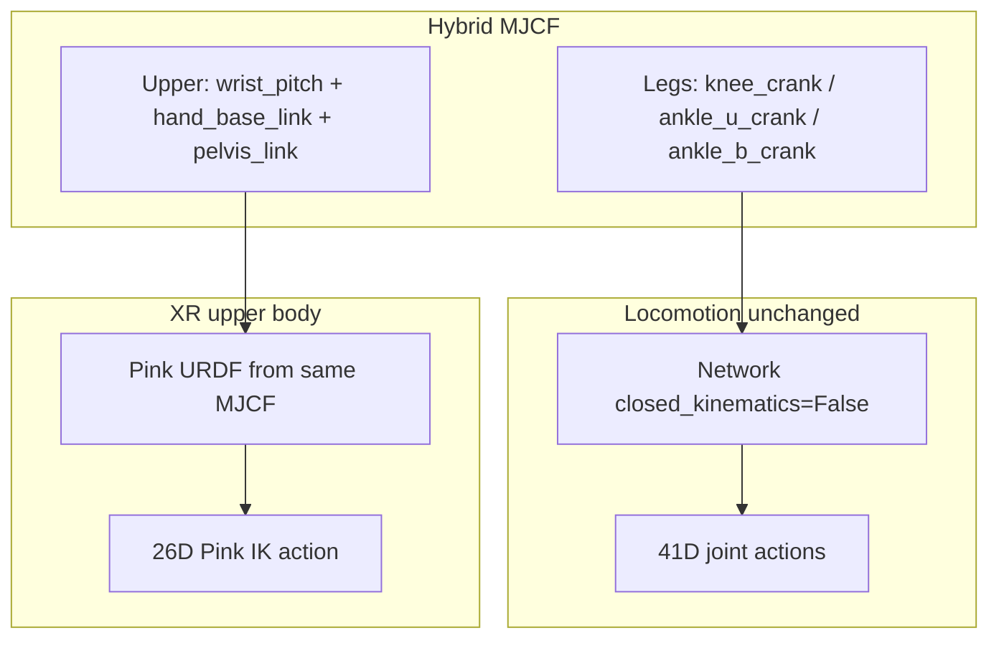

# Sberchel Hybrid Open-Kinematics Unification — Implementation Report

This report documents the **hybrid open-kinematics Sberchel** stack: one primary robot config (`SBERCHEL_CONFIG_OPEN_KINEMATICS`) that keeps **policy-native crank leg joints** while preserving a **Pink-friendly serial upper body** (`wrist_pitch`, `hand_base_link`, `pelvis_link`). It supersedes the interim approach that used `v3_0_alpha_locomanipulator_open.xml` with crank→serial remapping in `sberchel_policy.py`.

**Primary robot config:** `SBERCHEL_CONFIG_OPEN_KINEMATICS` in `dsynth_isaac/robots/sberchel_cfg.py`  
**Hybrid MJCF:** `dsynth_isaac/robots/mjcf/v3_0_alpha_locomanipulator_hybrid.xml` (meshes still from green_challenge)  
**Pink URDF pipeline:** `dsynth_isaac/robots/sberchel_mjcf_usd.py`  

**Related (unchanged) reports:** [`sberchel_upperbody_xr_teleop_report.md`](sberchel_upperbody_xr_teleop_report.md), [`sberchel_xr_locomotion_teleop_report.md`](sberchel_xr_locomotion_teleop_report.md) — these describe the pre-hybrid paths and are now partially outdated on MJCF/policy wiring.

---

## 1. Goal and motivation

### Problem

The earlier open-kinematics path used `v3_0_alpha_locomanipulator_open.xml`, which renamed leg joints to serial names (`knee_pitch`, `ankle_pitch`, `ankle_roll`). That broke **native** green_challenge locomotion policy I/O:

- Policy `model.joint_order` expects crank leg names (`left_knee_crank_joint`, etc.).
- A bridge module (`sberchel_policy.py`) remapped crank↔serial at runtime for sim indices, PD gains, and leg action targets.

This added complexity and diverged from how colleagues run policy experiments (`Network(..., closed_kinematics=False)` with no remapping).

### Target outcome (from plan)

One unified open robot used across:

| # | Use case | Task / script |
|---|----------|---------------|
| 1 | Zero-action collapse smoke test | `demo_random_actions.py` → `Dsynth-Fetch-Any-Item-Sberchel-Open-v0` |
| 2 | WASD locomotion, native policy | `demo_sberchel_kb.py` → same Open task |
| 3 | Fixed-pelvis upper-body XR teleop | `teleop_se3_agent.py` → `Dsynth-Fetch-Any-Item-Sberchel-Upperbody-XR-v0` |
| 4 | Free-floating loco + XR teleop | `teleop_sberchel.py` → `Dsynth-Fetch-Any-Item-Sberchel-XR-v0` |

**Constraint:** Leg joint names and policy action semantics must stay **identical to green_challenge** so locomotion experiments remain comparable.

**Verified:** All four paths above were smoke-tested successfully after implementation.

---

## 2. Why a hybrid MJCF (not an existing green_challenge robot)

| Source | Legs | Upper body | Pink / URDF |
|--------|------|------------|-------------|
| `v3_0a` closed | Crank + rods + `<connect>` loops | Crank wrists + rods | Bad for URDF export |
| `v3_0a` `_open.xml` | Serial `*_pitch_joint` / `*_roll_joint` | `wrist_pitch`, `hand_base_link` | Good for Pink |
| `green_open_source` default | Crank names, open tree | `wrist_crank`, **no `hand_base_link`** | Pink frame tasks break |

**Solution:** Fork `_open.xml` → `v3_0_alpha_locomanipulator_hybrid.xml` with **only six leg joint renames** (plus matching actuator/sensor references). Upper-body topology, `hand_base_link`, finger mimics, and open kinematic tree are unchanged.



---

## 3. Hybrid MJCF asset

**File:**  
`dsynth_isaac/robots/mjcf/v3_0_alpha_locomanipulator_hybrid.xml`

**Meshes:** green_challenge `.../v3_0_alpha_locomanipulator/meshes/` (absolute `meshdir` rewritten at import into a gitignored `*.resolved.xml`).

**USD cache:** `dsynth_isaac/robots/mjcf/usd_cache/`

**Created from:** green_challenge `v3_0_alpha_locomanipulator_open.xml`

| Open joint name | Hybrid (policy) name |
|-----------------|----------------------|
| `left_knee_pitch_joint` | `left_knee_crank_joint` |
| `left_ankle_pitch_joint` | `left_ankle_u_crank_joint` |
| `left_ankle_roll_joint` | `left_ankle_b_crank_joint` |
| (mirrored for `right_*`) | |

**Also updated:** `<general joint="...">` actuators and `<jointpos joint="...">` sensors referencing those joints.

**Explicitly not changed:**

- `pelvis_link`, floating base
- `wrist_pitch_joint` / `wrist_roll_joint` (not renamed to `wrist_crank`)
- `left_hand_base_link` / `right_hand_base_link`
- Finger mimic `<equality>` constraints
- No rod bodies or `<connect>` kinematic loops reintroduced

---

## 4. Robot configuration hierarchy

All configs live in `dsynth_isaac/robots/sberchel_cfg.py`.

### `SBERCHEL_CONFIG` (unchanged)

Closed-kinematics `robot_v3_0a` for `Isaac-Dsynth-Sberchel-Base-v0` / `SberchelBaseEnvCfg`. Colleagues experimenting on closed model are unaffected.

### `SBERCHEL_CONFIG_OPEN_KINEMATICS` (primary)

- **Interface JSON:** `ConfigManagerGreenOpenSource` → `sberchel_v3_0_alpha_locomanipulation_full` (motors cfg already uses crank leg regexes).
- **Spawn:** hybrid MJCF via `spawn_from_mjcf`.
- **Actuators:** single `motors` `FrictionalActuatorCfg` group from green_open_source, with one config remap:
  - `.*_wrist_crank_joint` → `.*_wrist_pitch_joint` in init_state and gain dicts (JSON still names wrists as crank; hybrid MJCF uses `wrist_pitch`).

### `SBERCHEL_UPPERBODY_XR_ROBOT`

Derived from open config:

- Same hybrid spawn
- `fix_root_link=True`, `disable_gravity=True`
- Single high-PD `ImplicitActuatorCfg` (`body`) locking legs/torso/neck, driving arms/fingers for teleop

### `SBERCHEL_XR_LOCOMOTION_ROBOT`

Derived from open config, free-floating pelvis:

- **Dual actuators:**
  - `locomotion` — green `motors` on legs + torso + neck only; gain dicts filtered to exclude upper-body keys (`_locomotion_gain_dict`)
  - `xr_upper` — `ImplicitActuatorCfg` for shoulders, elbows, wrists, finger proximals (Pink tracking)

`apply_sberchel_xr_teleop_pd_gains(robot)` raises arm/finger PD on the `xr_upper` group at runtime (used by `teleop_sberchel.py`, not by Open-only scripts).

---

## 5. Action spaces and env wiring

### Shared leg joint list

`POLICY_LEG_JOINT_NAMES` in `sberchel_base_env_cfg.py` — 12 crank leg joints matching `green_challenge.configs.chel_2_0_rl.model.joint_order` legs slice.

### `SberchelOpenKinematicsActionsCfg` (41D)

Used by `SberchelOpenKinematicsFetchAnyItemEnvCfg` (`Dsynth-Fetch-Any-Item-Sberchel-Open-v0`):

| Block | Joints |
|-------|--------|
| legs (12) | `POLICY_LEG_JOINT_NAMES` (crank) |
| torso (13) | same as `SberchelActionsCfg` |
| wrist (4) | `wrist_pitch` + `wrist_roll` (serial, not crank) |
| fingers (12) | same as `SberchelActionsCfg` |

**Robot:** `SBERCHEL_CONFIG_OPEN_KINEMATICS` (single `motors` actuator).

### `SberchelXRFetchAnyItemEnvCfg` (38D)

`Dsynth-Fetch-Any-Item-Sberchel-XR-v0`:

| Block | Dims | Driver |
|-------|------|--------|
| `legs_joint_pos` | 12 | Policy → crank leg targets |
| `upper_body_ik` | 26 | Pink IK (wrist poses + finger curls) |

**Robot:** `SBERCHEL_XR_LOCOMOTION_ROBOT` (split actuators).

### `UpperbodySberchelXRFetchAnyItemEnvCfg` (26D)

`Dsynth-Fetch-Any-Item-Sberchel-Upperbody-XR-v0` — unchanged Pink wiring; now backed by hybrid spawn via `SBERCHEL_UPPERBODY_XR_ROBOT`.

---

## 6. Native policy integration (removed `sberchel_policy.py`)

### Deleted

`dsynth_isaac/robots/sberchel_policy.py` — contained:

- `SberchelOpenLocomotionNetwork` (crank→serial sim index aliasing)
- `_POLICY_TO_OPEN_JOINT` / PD gain remapping
- `build_sberchel_locomotion_network`, `policy_leg_targets`, `OPEN_LEG_JOINT_NAMES`

### Replacement

**Direct policy:**

```python
from green_challenge.policy.network import Network
net = Network(env, type="zest", device="cpu", closed_kinematics=False)
```

**Leg targets helper** (thin wrapper, no name remapping):

```python
# dsynth_isaac/tasks/manager_based/sberchel_base_env_cfg.py
def policy_leg_targets(net, vx, vy, wz) -> list[float]:
    net.set_command_detailed(vx, vy, wz)
    net.set_joint_overrides({
        "torso_joint_pos": [0.0] * 13,
        "wrist_joint_pos": [0.0] * 4,
        "finger_joint_pos": [0.0] * 12,
    })
    loco = net(net.obs())
    return list(loco["joint_pos"][:12])
```

Policy `model.joint_order` has 25 entries (no wrist/finger DOFs); only the first 12 leg targets are written to sim. Upper body is padded with zeros in KB demos or driven by Pink in XR tasks.

### Updated scripts

| Script | Change |
|--------|--------|
| `scripts/demo_sberchel_kb.py` | Native `Network`; default task `Dsynth-Fetch-Any-Item-Sberchel-Open-v0`; 41D action padding |
| `scripts/teleop_sberchel.py` | Native `Network` + `policy_leg_targets`; legs(12) + Pink upper(26) |
| `scripts/teleop_sberchel_head_follow.py` | Same |
| `scripts/teleop_sberchel_body_rotate.py` | Same |

---

## 7. Pink URDF pipeline

`dsynth_isaac/robots/sberchel_mjcf_usd.py`:

- Resolves spawn USD from hybrid MJCF (via `SBERCHEL_CONFIG_OPEN_KINEMATICS.spawn` or derived robots sharing that spawn).
- `patch_mjcf_usd_for_urdf` — open tree, no `<connect>` constraints; `pelvis_link` URDF root.
- Cache versions bumped: `PINK_URDF_CACHE_VERSION = "v9_hybrid"`, `MJCF_USD_CACHE_VERSION = "hybrid_v1"`.

Leg crank joints exist in the exported URDF but are **not** in `pink_controlled_joint_names` — Pink still solves arms-only IK relative to `pelvis_link`, same as before.

`setup_sberchel_xr_pink_and_teleop()` in `sberchel_upperbody_xr_env_cfg.py` is unchanged; called from both upperbody XR and loco+XR envs.

---

## 8. Implementation issues encountered and fixes

### 8.1 Init state: `wrist_crank` vs `wrist_pitch`

**Symptom:** `ValueError: Not all regular expressions are matched` for `.*_wrist_crank_joint` on `Dsynth-Fetch-Any-Item-Sberchel-Open-v0`.

**Cause:** `green_open_source` interface JSON init_state uses `.*_wrist_crank_joint`; hybrid MJCF has `wrist_pitch_joint`.

**Fix:** `_HYBRID_JOINT_KEY_REMAP` + `_remap_hybrid_joint_keys()` applied to init_state and motors actuator cfg when building `SBERCHEL_CONFIG_OPEN_KINEMATICS`.

### 8.2 Loco+XR actuator init: upper-body gain keys on `locomotion` group

**Symptom:** `FrictionalActuator` init failed — shoulder/elbow/wrist regexes in motors gain dicts did not match the 15-joint `locomotion` `joint_names_expr`.

**Cause:** `_open_locomotion_actuators()` only narrowed `joint_names_expr` but left full motors stiffness/damping dicts.

**Fix:** `_locomotion_gain_dict()` filters out upper-body/finger keys before building the `locomotion` actuator (restored pattern from pre-hybrid code, without crank→serial leg remapping).

---

## 9. File change summary

| Path | Role |
|------|------|
| `dsynth_isaac/robots/mjcf/v3_0_alpha_locomanipulator_hybrid.xml` | **New** hybrid MJCF (local; meshes from green_challenge) |
| `dsynth_isaac/robots/sberchel_cfg.py` | Unified open/XR robot configs; hybrid wrist remap; split locomotion actuators |
| `dsynth_isaac/robots/sberchel_mjcf_usd.py` | Cache version bump for hybrid MJCF |
| `dsynth_isaac/tasks/manager_based/sberchel_base_env_cfg.py` | `POLICY_LEG_JOINT_NAMES`, `SberchelOpenKinematicsActionsCfg`, `policy_leg_targets` |
| `dsynth_isaac/tasks/manager_based/sberchel_xr_env_cfg.py` | `POLICY_LEG_JOINT_NAMES` for XR leg actions |
| `dsynth_isaac/robots/sberchel_policy.py` | **Deleted** |
| `scripts/demo_sberchel_kb.py` | Native policy, Open task default |
| `scripts/teleop_sberchel*.py` | Native policy for loco+XR variants |

**Not modified:** `SberchelBaseEnvCfg`, `SBERCHEL_CONFIG` (closed), Pink task definitions in `sberchel_upperbody_xr_env_cfg.py` (logic), `SberchelRetargeter`.

---

## 10. Test commands (verified)

```bash
# 1) Robot falls with zero actions
python scripts/demo_random_actions.py \
  --task Dsynth-Fetch-Any-Item-Sberchel-Open-v0 \
  --config_dir_path generated_envs/isaac_sample --num_envs 1

# 2) WASD locomotion, native policy (no sberchel_policy)
python scripts/demo_sberchel_kb.py \
  --task Dsynth-Fetch-Any-Item-Sberchel-Open-v0 \
  --config_dir_path generated_envs/isaac_sample

# 3) Fixed-pelvis upper-body XR teleop
../IsaacLab/isaaclab.sh -p scripts/teleop_se3_agent.py \
  --task Dsynth-Fetch-Any-Item-Sberchel-Upperbody-XR-v0 \
  --config_dir_path generated_envs/isaac_sample --enable_pinocchio

# 4) Free-floating loco + XR teleop
../IsaacLab/isaaclab.sh -p scripts/teleop_sberchel.py \
  --task Dsynth-Fetch-Any-Item-Sberchel-XR-v0 \
  --config_dir_path generated_envs/isaac_sample --enable_pinocchio
```

First launch per task regenerates hybrid MJCF→USD and Pink URDF caches (slow).

---

## 11. Plan vs implementation notes

| Plan item | Status | Note |
|-----------|--------|------|
| Hybrid MJCF (6 leg renames) | Done | Based on `_open.xml`, not green_open_source graft |
| `SBERCHEL_CONFIG_OPEN_KINEMATICS` as primary | Done | Uses green_open_source JSON + hybrid spawn |
| Remove `_POLICY_TO_OPEN_JOINT` / `sberchel_policy.py` | Done | Native `Network` everywhere |
| `SberchelHybridActionsCfg` name | Renamed | Implemented as `SberchelOpenKinematicsActionsCfg` (same semantics) |
| Upperbody XR minimal changes | Done | Spawn now hybrid-backed; Pink config unchanged |
| Loco+XR `POLICY_LEG_JOINT_NAMES` | Done | |
| Pink URDF cache bump | Done | |
| `_locomotion_gain_dict` for split actuators | Done | Added during loco+XR debug (not in original plan text) |
| `teleop_sberchel_upperbody_xr_compare.py` | Not re-run in final session | Recommended regression check for finger order |

---

## 12. Residual considerations

- **Policy wrist semantics:** Full 41D env actions include 4 wrist dims using `wrist_pitch`/`wrist_roll` on sim; policy internal wrist slice is zero-padded. Driving wrists from policy output would need an explicit crank→pitch mapping (not required today).
- **Closed robot path:** `SBERCHEL_CONFIG` + `SberchelActionsCfg` remain for closed-kinematics experiments.
- **Older reports:** [`sberchel_xr_locomotion_teleop_report.md`](sberchel_xr_locomotion_teleop_report.md) still references `sberchel_policy.py` and `_open.xml`; treat this document as the source of truth for the hybrid stack.
