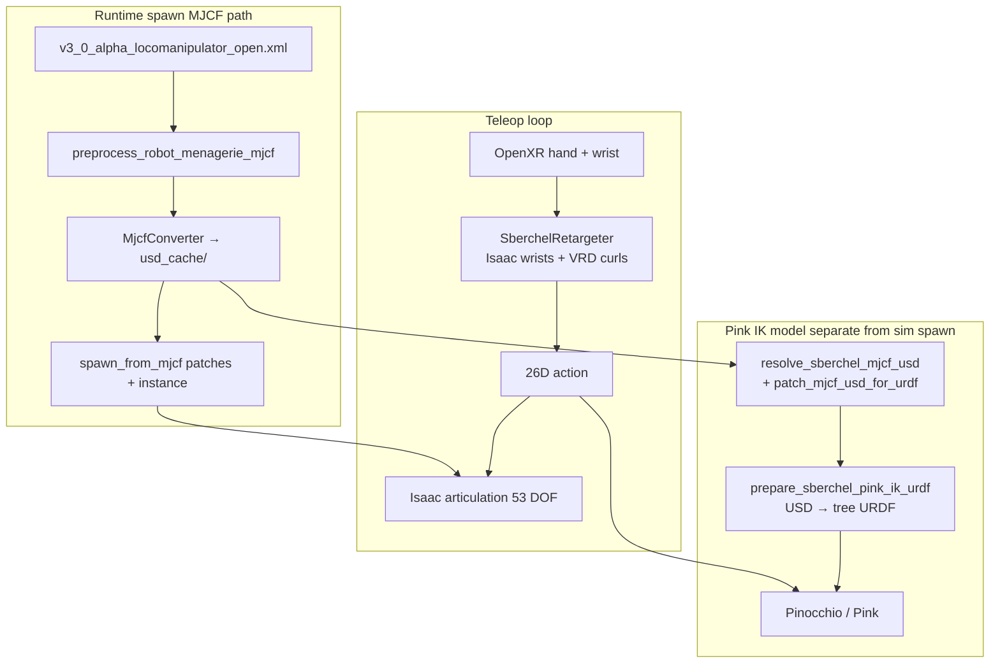

# Sberchel Open-Kinematics MJCF Upperbody XR Teleop — Implementation Report

This report documents the **MJCF upperbody** OpenXR teleop path: open-kinematics Sberchel spawned from green_challenge MJCF, fixed pelvis, Pink IK for arms, VRD-style finger curl for grasping.

**Working task:** `Dsynth-Fetch-Any-Item-Sberchel-Upperbody-XR-v0`  
**Env config:** `dsynth_isaac/tasks/manager_based/sberchel_upperbody_xr_env_cfg.py`  
**Robot config:** `SBERCHEL_UPPERBODY_XR_ROBOT` in `dsynth_isaac/robots/sberchel_cfg.py`  
**Retargeter:** `dsynth_isaac/devices/sberchel_retargeter.py`  
**Pink URDF pipeline:** `dsynth_isaac/robots/sberchel_mjcf_usd.py`  
**Compare / debug script:** `scripts/teleop_sberchel_upperbody_xr_compare.py`

---

## 1. Goal and outcome

**Goal:** Upper-body XR teleop on Sberchel with **open kinematics** (serial `wrist_pitch` + `wrist_roll`, no wrist crank/rod), **fixed pelvis**, spawning from green_challenge **MJCF** (`robot_green_open_source` + open XML).

**Outcome:**

- Gym task registers and loads; scene spawns open MJCF via `spawn_from_mjcf`.
- Pink IK drives wrists to `left_hand_base_link` / `right_hand_base_link` with OpenXR frame offsets.
- Fingers map correctly (thumb → thumb, index → index, etc.) after packing order fix.
- Finger range improved via VRD-style curl mapping (full extension at open hand, wider thumb opposition for grasp).
- Locomotion policy is **not** used; action is 26D Pink IK only.

**Explicitly not in scope:**

- Full-body XR with zest legs.
- DexPilot hand optimizer (legacy `sberchel_hand_urdf.py` path).

---

## 2. Architecture overview



**Important distinction:** MJCF spawn goes through an importer USD cache (`usd_cache/`). That is Isaac Sim’s MJCF pipeline, not a separate baked robot asset. Pink additionally needs a **patched** copy of that USD exported to URDF (`*_ik_export.usd` → `pink_ik_cache/`).

---

## 3. Robot and spawn configuration

### 3.1 ConfigManager and MJCF file

| Item | Value |
|------|--------|
| Package | `green_challenge.assets.robot_green_open_source` (`ConfigManagerGreenOpenSource`) |
| Interface JSON | `sberchel_v3_0_alpha_locomanipulation_full` |
| Open MJCF | `green_challenge/.../v3_0_alpha_locomanipulator/v3_0_alpha_locomanipulator_open.xml` |
| Spawn cfg | `MJCFFileCfg` → `spawn_from_mjcf` |
| USD cache | `.../v3_0_alpha_locomanipulator/usd_cache/v3_0_alpha_locomanipulator_open.usd` |

Constants: `SBERCHEL_CONFIG_OPEN_KINEMATICS`, `SBERCHEL_UPPERBODY_XR_ROBOT` in `sberchel_cfg.py`.

### 3.2 Upperbody XR robot differences vs base open config

- `fix_root_link=True` on articulation root (pelvis fixed).
- `disable_gravity=True` on rigid bodies.
- `ImplicitActuatorCfg` PD groups: high stiffness on legs/torso/neck (locked), arm/finger gains for teleop.
- `init_state.joint_pos` remapped from closed JSON keys (crank joints dropped, `wrist_crank` → `wrist_pitch`, serial leg defaults added).

Closed kinematics locomotion remains on `SBERCHEL_CONFIG` + `SberchelBaseEnvCfg` (`sberchel_base_env_cfg.py`).

### 3.3 Joint inventory (open model, actuated masters)

Pink commands **41** proximal / arm joints via actuators; **12** intermediate/distal finger joints are PhysX mimics (53 DOF total). Warning `41 != 53` at startup is expected.

---

## 4. Environment and Gym registration

| Field | Setting |
|-------|---------|
| Class | `UpperbodySberchelXRFetchAnyItemEnvCfg` |
| Base | `DarkstoreBaseEnvCfg` |
| Actions | `UpperbodySberchelXRActionsCfg` — Pink 26D only |
| Events | `SberchelEventCfg` (startup base pose at stand height) |
| Observations | `SberchelObservationsCfg` (minimal policy group) |
| Entry point | `FetchItemEnv` (fetch scene + target regex) |

Registration in `dsynth_isaac/tasks/manager_based/__init__.py`:

```text
Dsynth-Fetch-Any-Item-Sberchel-Upperbody-XR-v0
```

---

## 5. Action layout (26D)

```text
[left_wrist (7) | right_wrist (7) | hand joints (12)]
```

- Wrists: world-frame position + quaternion (wxyz), absolute OpenXR wrist × static `hand_base_link` offset `(0.5, 0.5, 0.5, 0.5)`.
- Hands: 12 proximal master joints only (mimics follow MJCF equality / PhysX mimic).

### 5.1 Hand packing order (must match Pink)

Pink `find_joints(..., preserve_order=False)` applies the last 12 action dims in **articulation DOF order**, not MJCF logical name order.

```text
left_thumb_proximal_yaw_joint
left_index_proximal_joint
left_middle_proximal_joint
left_ring_proximal_joint
left_pinky_proximal_joint
right_thumb_proximal_yaw_joint
right_index_proximal_joint
right_middle_proximal_joint
right_ring_proximal_joint
right_pinky_proximal_joint
left_thumb_proximal_pitch_joint
right_thumb_proximal_pitch_joint
```

Defined as `SBERCHEL_HAND_JOINT_NAMES` in `sberchel_upperbody_xr_env_cfg.py`. **Do not** use the MJCF-style list (thumb pitch immediately after yaw per hand) — that caused digit swap before fix.

---

## 6. Pink IK and URDF pipeline (`sberchel_mjcf_usd.py`)

GR1T2-style `ControllerUtils.convert_usd_to_urdf` on raw `MjcfConverter` output **fails** for Sberchel (duplicate articulation roots, kinematic loops, MJCF `root` hierarchy skip edges).

### 6.1 Steps at env `__post_init__`

1. `resolve_sberchel_spawn_usd_path(spawn)`  
   - `preprocess_robot_menagerie_mjcf` (mesh renames, e.g. ZED STL names)  
   - `MjcfConverter` → `usd_cache/`  
   - Copy to `*_ik_export.usd`  
   - `patch_mjcf_usd_for_urdf` (duplicate roots, mimic setup, **no** equality connects — loops break URDF export)

2. `prepare_sberchel_pink_ik_urdf(patched_usd)`  
   - `convert_sberchel_usd_to_urdf` with `pelvis_link` root + skip-edge removal  
   - URDF sanitize for Pinocchio  
   - Cache under `usd_cache/pink_ik_cache/`

### 6.2 Role of `sberchel_mjcf_usd.py`

`sberchel_mjcf_usd.py` patches the **MJCF importer’s USD cache** for tree URDF export. The upperbody env uses `resolve_sberchel_mjcf_usd` plus `prepare_sberchel_pink_ik_urdf` at startup.

---

## 7. Retargeting (`SberchelRetargeter`)

### 7.1 Wrists (Isaac path, not VRD)

- Absolute OpenXR wrist pose in world frame.
- Right-multiply quaternion offset to `hand_base_link` control frame.
- Pink IK tracks `left_hand_base_link` / `right_hand_base_link` with `base_link_name="pelvis_link"`.

Derived via `scripts/derive_sberchel_openxr_wrist_offset.py`.

### 7.2 Fingers (VRD-style curl — current)

After initial joint-to-joint mapping proved too limited (index not fully extending, thumb yaw not reaching sideways grasp), finger math was aligned with VisionRobotDemo:

| Joint | Mapping |
|-------|---------|
| Digits | Multi-segment `digitCurl` → normalized [0,1] → `closeFraction × span [0, 1.7]` |
| Thumb pitch | `thumbFlexionCurl` → span `[0, 0.5]` |
| Thumb yaw | Palm-plane angle **−50°…12°** → opposition [0,1] → span `[-0.1, 1.3]` |

Constants: normalizers, deadzones, `_CLOSE_FRACTION`, `_FINGER_BLEND = 0.28` — see `sberchel_retargeter.py` (annotated from VRD / `MuJoCoBridge.mm`).

**Not used:** DexPilot, dex-hand URDF optimizers, `dex_cache_dir` on retargeter cfg (fields kept for API compatibility).

### 7.3 Thumb joint roles

| Robot joint | Human cue | Notes |
|-------------|-----------|--------|
| `*_thumb_proximal_pitch_joint` | Flexion / curl toward palm | VRD thumb curl |
| `*_thumb_proximal_yaw_joint` | Opposition / sideways in palm plane | Angle-calibrated map; needed for wide grasp |

---

## 8. Issues encountered and fixes

| # | Symptom | Cause | Fix |
|---|---------|-------|-----|
| 1 | `MJCFFileCfg` has no `usd_path` | Pink setup assumed `UsdFileCfg` | `MjcfConverter` after preprocess |
| 2 | MJCF import fails on ZED meshes | Raw converter skips `preprocess_robot_menagerie_mjcf` | Preprocess before convert (same as `spawn_from_mjcf`) |
| 3 | URDF export: kinematic loops / duplicate roots | Raw MJCF USD not a tree | `sberchel_mjcf_usd.patch_mjcf_usd_for_urdf` |
| 4 | Actuator / init regex mismatch on crank joints | `init_state.joint_pos` from closed JSON | `_joint_dict_for_open_kinematics` + leg defaults |
| 5 | Wrong digit moves (thumb OK, index↔pinky swap) | Hand action packed in MJCF name order | `SBERCHEL_HAND_JOINT_NAMES` = articulation DOF order |
| 6 | Fingers don’t fully extend; thumb yaw short | Single-segment radian clip mapping | VRD curl + angle thumb opposition in `SberchelRetargeter` |

Unresolved USD payload warnings on `*_ik_export.usd` (missing `configuration/*_sensor.usd` references) appear at runtime but sim spawn uses the main `usd_cache` asset; generally harmless for teleop.

---

## 9. Key files

| Path | Role |
|------|------|
| `dsynth_isaac/tasks/manager_based/sberchel_upperbody_xr_env_cfg.py` | Upperbody XR env, Pink actions, `SBERCHEL_HAND_JOINT_NAMES`, teleop device wiring |
| `dsynth_isaac/tasks/manager_based/__init__.py` | Gym registration |
| `dsynth_isaac/robots/sberchel_cfg.py` | `SBERCHEL_CONFIG_OPEN_KINEMATICS`, `SBERCHEL_UPPERBODY_XR_ROBOT` |
| `dsynth_isaac/robots/sberchel_mjcf_usd.py` | MJCF USD resolve, URDF export for Pink |
| `dsynth_isaac/devices/sberchel_retargeter.py` | OpenXR → wrists + VRD finger curls |
| `dsynth_isaac/tasks/manager_based/sberchel_base_env_cfg.py` | Closed MJCF locomotion env (unchanged XR) |
| `scripts/teleop_sberchel_upperbody_xr_compare.py` | Landmark vs robot dumps + Pink order assert |
| `scripts/teleop_se3_agent.py` | Standard Isaac Lab XR teleop driver |

---

## 10. Contracts (do not break)

1. **Spawn:** Open MJCF path `v3_0_alpha_locomanipulator_open.xml` via `robot_green_open_source` + `usd_cache/`.
2. **Pink URDF:** Use patched `*_ik_export.usd` + `pink_ik_cache/`; do not call raw `convert_usd_to_urdf` on unpatched MJCF USD.
3. **Hand packing:** `SBERCHEL_HAND_JOINT_NAMES` must match Pink resolved order (thumb pitch **last** per side grouping).
4. **Proximals only:** 12D hand action commands proximal masters; do not add intermediate/distal to action or high-PD actuators on mimics.
5. **Init poses:** No closed crank joint keys in `init_state.joint_pos` for open model.
6. **Retargeter:** Wrist offsets stay paired with Pink `target_eef_link_names` (`*_hand_base_link`).

---

## 11. How to run

**Teleop:**

```bash
../IsaacLab/isaaclab.sh -p scripts/teleop_se3_agent.py \
  --task Dsynth-Fetch-Any-Item-Sberchel-Upperbody-XR-v0 \
  --teleop_device handtracking \
  --enable_pinocchio
```

**Compare / debug dumps:**

```bash
../IsaacLab/isaaclab.sh -p scripts/teleop_sberchel_upperbody_xr_compare.py \
  --task Dsynth-Fetch-Any-Item-Sberchel-Upperbody-XR-v0 \
  --teleop_device handtracking \
  --enable_pinocchio \
  --print_every_n 30 \
  --log_file /tmp/sberchel_upperbody_xr_compare.log
```

Press **START** in XR after the sim is ready. First launch is slow (MJCF→USD, USD patch, URDF export, scene build).

**Optional cache reset** if conversion gets stuck:

```bash
rm -rf /path/to/green_challenge/.../v3_0_alpha_locomanipulator/usd_cache/pink_ik_cache
rm -f /path/to/green_challenge/.../usd_cache/*_ik_export.usd
```

---

## 12. Optional follow-ups

- Per-headset tuning of `_THUMB_ANGLE_OPEN_DEG` / `_THUMB_ANGLE_FULL_DEG` if opposition saturates early or late.
- Reduce duplicate MJCF→USD work (env cfg Pink export vs runtime `spawn_from_mjcf` both convert; cache paths are aligned but work is repeated).
- Fix or silence `*_ik_export.usd` payload warnings if they ever affect sim.
- Re-enable DexPilot only if optimizer-based fingertips are required (packing order still mandatory).

---

## 13. One-line summary

**MJCF open-kinematics upperbody XR = green_challenge open MJCF spawn + fixed pelvis + `sberchel_mjcf_usd` Pink URDF + articulation-order hand packing + Isaac wrists and VRD finger curls in `SberchelRetargeter`.**
