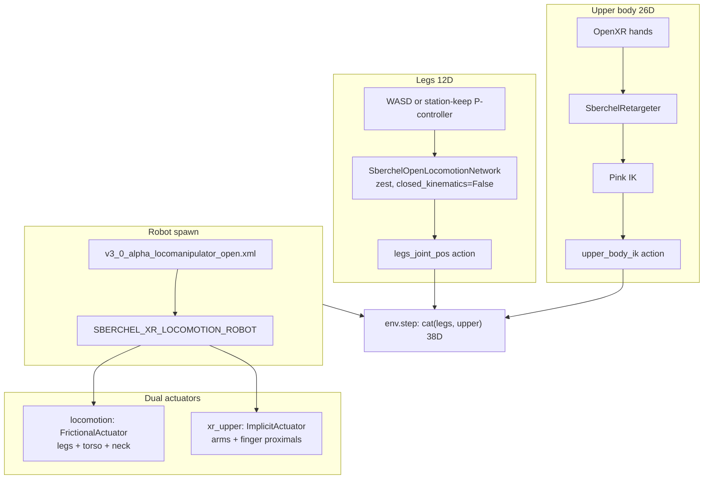

# Sberchel Open-Kinematics XR Locomotion + Teleop — Implementation Report

This report documents the **full-body** open-kinematics Sberchel stack: free-floating pelvis, green_challenge **zest** locomotion policy on legs, and OpenXR **Pink IK** upper-body teleop on the same robot and Gym task.

**Working task:** `Dsynth-Fetch-Any-Item-Sberchel-XR-v0`  
**Env config:** `dsynth_isaac/tasks/manager_based/sberchel_xr_env_cfg.py`  
**Robot config:** `SBERCHEL_XR_LOCOMOTION_ROBOT` in `dsynth_isaac/robots/sberchel_cfg.py`  
**Policy bridge:** `dsynth_isaac/robots/sberchel_policy.py`  
**Keyboard demo:** `scripts/demo_sberchel_kb.py`  
**VR teleop:** `scripts/teleop_sberchel.py`  

Builds on the fixed-pelvis upperbody path documented in [`sberchel_upperbody_xr_teleop_report.md`](sberchel_upperbody_xr_teleop_report.md).

---

## 1. Goal and outcome

**Goal:** Use the **same open-kinematics MJCF** Sberchel as the upperbody XR teleop robot, but with:

- **Free pelvis** (locomotion-capable biped, not `fix_root_link`)
- **Legs** driven by the existing zest ONNX policy (`closed_kinematics=False`)
- **Upper body** driven by the same XR retargeting + Pink IK as `UpperbodySberchelXRFetchAnyItemEnvCfg`
- Two entry scripts on **one** registered env:
  - `demo_sberchel_kb.py` — WASD velocity → policy legs, idle Pink upper body
  - `teleop_sberchel.py` — station-keep velocity → policy legs, live XR upper body

**Outcome:**

- Task registers and loads; scene spawns open MJCF with dual actuator groups (policy legs + XR arms).
- Keyboard demo and VR teleop both verified working.
- Policy reads/writes open joint names on the sim robot while still using crank-named policy internals.
- Pink URDF + teleop device wiring reused from upperbody XR via `setup_sberchel_xr_pink_and_teleop()`.

---

## 2. Architecture overview



**Action concat order (critical):** `[legs(12), upper_body_ik(26)]` — `legs_joint_pos` is declared **first** in `SberchelXRActionsCfg`.

---

## 3. How this differs from prior Sberchel envs

| Aspect | `SberchelBaseEnvCfg` | `UpperbodySberchelXRFetchAnyItemEnvCfg` | `SberchelXRFetchAnyItemEnvCfg` |
|--------|----------------------|----------------------------------------|--------------------------------|
| MJCF | Closed (`SBERCHEL_CONFIG`) | Open | Open |
| Pelvis | Free | **Fixed** | **Free** |
| Leg actuators | Closed crank names | Locked (high PD) | Policy `FrictionalActuator` |
| Arm actuators | Policy motors | ImplicitActuator (XR) | ImplicitActuator (`xr_upper`) |
| Actions | 41D joint pos | 26D Pink only | **12D legs + 26D Pink** |
| Locomotion policy | Yes (closed kin) | No | Yes (`closed_kinematics=False`) |
| XR teleop | No | Yes | Yes |

---

## 4. Robot configuration (`SBERCHEL_XR_LOCOMOTION_ROBOT`)

**File:** `dsynth_isaac/robots/sberchel_cfg.py`

### 4.1 Spawn

Same open MJCF as upperbody XR:

- Package: `robot_green_open_source`
- File: `v3_0_alpha_locomanipulator_open.xml`
- Base: `SBERCHEL_CONFIG_OPEN_KINEMATICS.spawn`
- **No** `fix_root_link` — floating base

### 4.2 Init pose

Reuses `_joint_dict_for_open_kinematics()` (drops closed crank joints, maps wrist crank → pitch, adds serial leg defaults). Elbow pitch set to `-1.0` for a natural arm pose.

### 4.3 Dual actuator groups

**`locomotion`** — derived from green_challenge `motors` `FrictionalActuatorCfg`:

- `joint_names_expr`: hips, `knee_pitch`, `ankle_pitch`, `ankle_roll`, `torso_yaw`, `neck_*` only
- All dict-valued motor fields (`stiffness`, `damping`, `effort_limit`, `viscous_coeff`, `force_control`, etc.) passed through `_remap_locomotion_gain_keys()`:
  - Replace crank substrings (`knee_crank` → `knee_pitch`, `ankle_u_crank` → `ankle_pitch`, …)
  - **Drop** upper-body / finger / remaining `crank` keys so Isaac Lab does not fail regex matching

**`xr_upper`** — `ImplicitActuatorCfg` (same gains as `SBERCHEL_UPPERBODY_XR_ROBOT` arms/fingers):

- Shoulders, elbows, wrists, finger **proximals** only
- High stiffness/damping for Pink IK tracking

**`apply_sberchel_xr_teleop_pd_gains(robot)`** — runtime helper that re-applies arm/finger PD on `xr_upper` after reset (legs left to policy PD restore).

### 4.4 Policy ↔ open joint name map

```text
left_knee_crank_joint      → left_knee_pitch_joint
left_ankle_u_crank_joint   → left_ankle_pitch_joint
left_ankle_b_crank_joint   → left_ankle_roll_joint
(same for right)
left_wrist_crank_joint     → left_wrist_pitch_joint
right_wrist_crank_joint    → right_wrist_pitch_joint
```

Defined as `_POLICY_TO_OPEN_JOINT` in `sberchel_cfg.py`.

---

## 5. Policy bridge (`sberchel_policy.py`)

The zest policy in `green_challenge` is always defined in **crank joint naming** (`model_joint_order` in `configs/chel_2_0_rl/model.py`). Open MJCF uses serial names. `Network.__init__` would fail on `robot_joint_names.index("left_knee_crank_joint")`.

### 5.1 `closed_kinematics=False`

Both scripts use:

```python
SberchelOpenLocomotionNetwork(env, type="zest", closed_kinematics=False)
```

This flag (already used in `demo_sberchel_kb.py` before this work):

- Skips ankle motor↔joint M2J/J2M transforms in obs and action output
- Scales ankle PD gains for joint-space actuators (`2u²`, `2b²` on u/b crank gains)

It does **not** fix joint **name** mismatches — that is handled below.

### 5.2 `SberchelOpenLocomotionNetwork`

Custom `Network` subclass that:

1. Builds the zest controller with `closed_kinematics=False`
2. Rebuilds `_sim_indices` using `resolve_open_kinematics_joint_name()` + `_POLICY_TO_OPEN_JOINT`
3. Calls `_restore_open_pd_gains()` — remaps policy cfg stiffness/damping keys onto **open** actuator joint names (with ankle gain scaling), then writes to sim actuators

### 5.3 `policy_leg_targets(net, vx, vy, wz)`

Shared by both scripts:

```python
net.set_command_detailed(vx, vy, wz)
net.set_joint_overrides({
    "torso_joint_pos": [0.0] * 13,
    "wrist_joint_pos": [0.0] * 4,
    "finger_joint_pos": [0.0] * 12,
})
loco = net(net.obs())
return list(loco["joint_pos"][:12])  # OPEN_LEG_JOINT_NAMES order (1:1 with policy layout)
```

Policy outputs are in model order; the first 12 values align 1:1 with `OPEN_LEG_JOINT_NAMES` semantic layout (hips, then knee/ankle serial targets).

### 5.4 Open leg action names

```text
left_hip_pitch_joint, left_hip_roll_joint, left_hip_yaw_joint,
left_knee_pitch_joint, left_ankle_pitch_joint, left_ankle_roll_joint,
(right side same pattern)
```

---

## 6. Environment and Gym registration

**File:** `dsynth_isaac/tasks/manager_based/sberchel_xr_env_cfg.py`

| Field | Setting |
|-------|---------|
| Class | `SberchelXRFetchAnyItemEnvCfg` |
| Base | `DarkstoreBaseEnvCfg` |
| Robot | `SBERCHEL_XR_LOCOMOTION_ROBOT` |
| Actions | `SberchelXRActionsCfg` |
| Events | `SberchelEventCfg` (stand height 0.9 m) |
| Observations | `SberchelObservationsCfg` |
| Sim | `dt=1/150`, `decimation=1` (locomotion-friendly) |
| Pink + teleop | `setup_sberchel_xr_pink_and_teleop(self)` |

**Registration** (`dsynth_isaac/tasks/manager_based/__init__.py`):

```text
Dsynth-Fetch-Any-Item-Sberchel-XR-v0
```

Entry point: `FetchItemEnv` (same fetch scene / target regex as other darkstore tasks).

### 6.1 Shared XR setup (refactor)

`setup_sberchel_xr_pink_and_teleop(cfg)` was extracted to `sberchel_upperbody_xr_env_cfg.py` and is called from **both**:

- `UpperbodySberchelXRFetchAnyItemEnvCfg` (fixed pelvis, Pink-only)
- `SberchelXRFetchAnyItemEnvCfg` (locomotion + Pink)

It performs:

1. `resolve_sberchel_spawn_usd_path` + `prepare_sberchel_pink_ik_urdf` → sets `upper_body_ik.controller.urdf_path`
2. Wires `teleop_devices` with `SberchelRetargeterCfg` (handtracking + manusvive)

Upper-body Pink action config is **reused** via:

```python
upper_body_ik = UpperbodySberchelXRActionsCfg().upper_body_ik
```

Hand packing order, wrist frame offsets, and VRD finger curls are unchanged — see upperbody report §5.

---

## 7. Action layout (38D total)

```text
[legs(12) | upper_body_ik(26)]
```

**Legs (12):** absolute joint positions from policy → `JointPositionActionCfg` on `OPEN_LEG_JOINT_NAMES`.

**Upper body (26):** same as upperbody XR:

```text
[left_wrist(7) | right_wrist(7) | hand_joints(12)]
```

Wrists: world-frame pos + quat (wxyz). Hands: `SBERCHEL_HAND_JOINT_NAMES` (articulation DOF order — thumb pitch last per side grouping).

---

## 8. Runtime scripts

### 8.1 `scripts/demo_sberchel_kb.py`

**Purpose:** Keyboard-only locomotion test on the **same** XR env (no headset).

**Flow each step:**

1. WASD/QE → body-frame `(vx, vy, wz)`
2. `legs = policy_leg_targets(net, vx, vy, wz)`
3. `idle_upper` = current `left_hand_base_link` / `right_hand_base_link` poses + 12 zero finger joints
4. `env.step(cat(legs, idle_upper))`

**Pinocchio:** imported **before** `AppLauncher` when task name contains `sberchel` + `xr` (Pink action term initializes even for idle upper body). Without this, Pinocchio/eigenpy fails with `No Python class registered for C++ class std::vector<...>`.

**After reset:** `apply_sberchel_xr_teleop_pd_gains(robot)`.

### 8.2 `scripts/teleop_sberchel.py`

**Purpose:** VR teleop upper body + policy-balanced legs.

**Flow each step:**

1. Station-keep P-controller → `(vx, vy, wz)` toward spawn `(x, y, yaw)`
2. `legs = policy_leg_targets(net, vx, vy, wz)`
3. If teleop active: `upper_body = teleop_interface.advance()` (26D from retargeter)
4. Else: idle upper body from robot hand_base poses
5. `env.step(cat(legs, upper_body))`

**XR:** `--teleop_device handtracking` enables XR mode; press **START** to activate teleop.

**Policy:** `build_sberchel_locomotion_network(env)` with `closed_kinematics=False`.

---

## 9. Issues encountered and fixes

| # | Symptom | Cause | Fix |
|---|---------|-------|-----|
| 1 | `AttributeError: 'NoneType' has no attribute 'items'` on import | `motors.friction` is `None` in green_challenge JSON | `_remap_locomotion_gain_keys` returns `None` for `None` input; only remap dict fields |
| 2 | `ValueError: Not all regular expressions are matched` (crank + upper-body keys) | Remap kept **both** old crank regexes and new open ones | Replace crank substrings in keys; filter out shoulder/finger/crank entries |
| 3 | Same error on `viscous_coeff` | `viscous_coeff` not in original manual remap list | Iterate **all** dict fields on `motors` cfg via `dataclasses.fields` |
| 4 | `TypeError: No Python class registered for std::vector<...>` | Pink IK needs Pinocchio imported before Isaac Sim | Auto-import `pinocchio` in `demo_sberchel_kb.py` for Sberchel XR tasks |
| 5 | `Network.__init__` would fail on open robot | Policy `model_joint_order` uses crank names absent from open MJCF | `SberchelOpenLocomotionNetwork` + `_POLICY_TO_OPEN_JOINT` sim index alias |
| 6 | Leg PD gains not applied to open actuators | Policy cfg keys are crank-named | `_restore_open_pd_gains` remaps keys to open joint names |

---

## 10. Key files

| Path | Role |
|------|------|
| `dsynth_isaac/tasks/manager_based/sberchel_xr_env_cfg.py` | Full-body XR + locomotion env |
| `dsynth_isaac/tasks/manager_based/sberchel_upperbody_xr_env_cfg.py` | Shared Pink/teleop setup + upperbody-only env |
| `dsynth_isaac/robots/sberchel_cfg.py` | `SBERCHEL_XR_LOCOMOTION_ROBOT`, actuator remap, `apply_sberchel_xr_teleop_pd_gains` |
| `dsynth_isaac/robots/sberchel_policy.py` | Open-kinematics policy network + `policy_leg_targets` |
| `dsynth_isaac/devices/sberchel_retargeter.py` | OpenXR → wrists + VRD finger curls (unchanged) |
| `dsynth_isaac/robots/sberchel_mjcf_usd.py` | Pink URDF pipeline (unchanged) |
| `dsynth_isaac/tasks/manager_based/__init__.py` | Gym registration |
| `scripts/demo_sberchel_kb.py` | WASD + policy legs + idle Pink |
| `scripts/teleop_sberchel.py` | XR teleop + policy legs (station-keep) |

---

## 11. Contracts (do not break)

1. **Action order:** `legs_joint_pos` before `upper_body_ik` in `SberchelXRActionsCfg` (scripts concat legs first).
2. **Hand packing:** `SBERCHEL_HAND_JOINT_NAMES` articulation DOF order (see upperbody report).
3. **Pink URDF:** patched `*_ik_export.usd` + `pink_ik_cache/` — do not use raw MJCF USD for Pink.
4. **Policy flag:** `closed_kinematics=False` for open MJCF; use `SberchelOpenLocomotionNetwork`, not raw `Network`.
5. **Pinocchio:** import before `AppLauncher` for any task that registers Pink IK actions.
6. **Locomotion actuator dicts:** only leg/torso/neck regex keys after `_remap_locomotion_gain_keys`.
7. **Retargeter:** wrist offsets paired with `*_hand_base_link` Pink targets.

---

## 12. How to run

**Keyboard locomotion (no VR):**

```bash
python scripts/demo_sberchel_kb.py --config_dir_path generated_envs/isaac_sample
```

**VR teleop + policy legs:**

```bash
python scripts/teleop_sberchel.py \
  --config_dir_path generated_envs/isaac_sample \
  --teleop_device handtracking \
  --enable_pinocchio
```

First launch is slow (MJCF→USD, USD patch, URDF export, scene build).

**Optional cache reset** if Pink conversion gets stuck (same as upperbody report):

```bash
rm -rf .../v3_0_alpha_locomanipulator/usd_cache/pink_ik_cache
rm -f .../usd_cache/*_ik_export.usd
```

---

## 13. Tuning knobs

| Knob | Location | Effect |
|------|----------|--------|
| WASD speeds | `demo_sberchel_kb.py` `--speed`, `--turn`, `--strafe` | Locomotion velocity command |
| Station-keep | `teleop_sberchel.py` `--hold_*` | How aggressively legs return to spawn pose |
| XR anchor | `SberchelXRFetchAnyItemEnvCfg.xr` | VR reference frame |
| Arm/finger PD | `apply_sberchel_xr_teleop_pd_gains`, `_XR_*` constants in `sberchel_cfg.py` | Pink tracking stiffness |
| Finger curls | `sberchel_retargeter.py` | Grasp feel (shared with upperbody XR) |

---

## 14. Optional follow-ups

- Locomotion-only env variant (no Pink) for faster keyboard-only iteration without Pinocchio startup cost.
- Drive legs from WASD inside `teleop_sberchel.py` instead of station-keep (user may want to walk while manipulating).
- Reduce duplicate MJCF→USD work between env Pink export and runtime `spawn_from_mjcf`.
- Tune `sim.dt` / `decimation` if Pink tracking is poor at 150 Hz (upperbody uses 120 Hz / decimation 6).

---

## 15. One-line summary

**Open-kinematics full-body Sberchel XR = free pelvis + dual actuators (policy legs, XR arms) + `SberchelOpenLocomotionNetwork` crank→serial bridge + reused upperbody Pink/retargeting + 38D action `[legs(12), Pink(26)]` on `Dsynth-Fetch-Any-Item-Sberchel-XR-v0`.**
