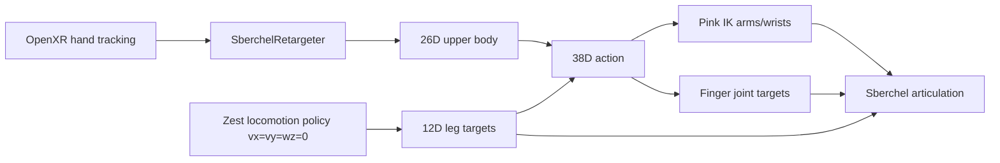

# Sberchel XR Teleoperation (Isaac Lab 2.3.2)

This document summarizes how OpenXR hand-tracking teleoperation was added for the Sberchel v3.0a locomanipulator on Isaac Lab **2.3.2**, adapting patterns from GR1T2 in this repo and from the working `sberchel_teleop` branch (Isaac Lab 3.0 beta).

**Converted-path success writeup** (what fixed digits vs thumb yaw, VRD vs DexPilot, MJCF vs baked USD, and what was taken from VisionRobotDemo): [sberchel_converted_xr_teleop_report.md](sberchel_converted_xr_teleop_report.md).

## Goal

- Upper body: VR hand tracking → Pink IK (wrists) + dex-retargeting (fingers)
- Legs: green_challenge zest locomotion policy with velocity command `(0, 0, 0)` (stand / balance)
- Same darkstore fetching scene as other RoboBenchMart tasks

## Converted USD XR

Additive path (does **not** change MJCF `UpperbodySberchelXR*` / `SberchelXR*`):

| Gym ID | Notes |
|--------|--------|
| `Dsynth-Fetch-Any-Item-Sberchel-Converted-Upperbody-XR-v0` | Open baked USD + fixed pelvis + VisionRobotDemo finger curl |
| `Dsynth-Fetch-Any-Item-Sberchel-Converted-XR-v0` | Closed converted USD + **free pelvis**; native zest crank legs; Pink IK URDF from **open** USD (closed has kinematic loops) |

**Converted finger contracts (see report for detail):**

- Pink hand packing order: `CONVERTED_SBERCHEL_HAND_JOINT_NAMES` (thumb pitch **after** digit proximals — not MJCF `SBERCHEL_HAND_JOINT_NAMES`).
- Thumb yaw: palm-plane angle **−50° → 12°** → joint `[-0.1, 1.3]` in `sberchel_converted_retargeter.py`.
- Digit curls: VRD multi-segment curl × closeFraction (not DexPilot).

Bake open USD (once, for Upperbody-XR):

```bash
/home/soshin/miniconda3/envs/env_isaaclab/bin/python scripts/bake_sberchel_usd.py --open --headless
```

Fixed-pelvis upperbody teleop:

```bash
./IsaacLab/isaaclab.sh -p scripts/teleop_se3_agent.py \
  --task Dsynth-Fetch-Any-Item-Sberchel-Converted-Upperbody-XR-v0 \
  --teleop_device handtracking \
  --enable_pinocchio
```

Floating-pelvis (closed USD + native zest station-keep, upper body via XR):

```bash
./IsaacLab/isaaclab.sh -p scripts/teleop_sberchel.py \
  --config_dir_path generated_envs/isaac_sample \
  --task Dsynth-Fetch-Any-Item-Sberchel-Converted-XR-v0 \
  --teleop_device handtracking \
  --enable_pinocchio
```

Diagnostic dumps (OpenXR landmarks vs robot finger links + q/q_des):

```bash
./IsaacLab/isaaclab.sh -p scripts/teleop_sberchel_xr_compare.py \
  --task Dsynth-Fetch-Any-Item-Sberchel-Converted-Upperbody-XR-v0 \
  --teleop_device handtracking \
  --enable_pinocchio \
  --print_every_n 30 \
  --log_file /tmp/sberchel_xr_compare.log
```

## How to run (MJCF / legacy)

```bash
python scripts/teleop_sberchel.py \
  --config_dir_path generated_envs/isaac_sample \
  --teleop_device handtracking \
  --enable_pinocchio
```

Optional: clear Pink / dex caches after URDF export logic changes:

```bash
rm -rf \
  /home/krapukhin/projects/green-challenge/assets/robot_v3_0a/dependencies/robots/v3_0_alpha_locomanipulator/usd_cache/pink_ik_cache
```

Press **START** in XR to begin teleop; **R** / reset gesture to reset.

## Registered environment

| Gym ID | Config class |
|--------|----------------|
| `Dsynth-Fetch-Any-Item-Sberchel-XR-v0` | `SberchelXRFetchAnyItemEnvCfg` |

Registration: `dsynth_isaac/tasks/manager_based/__init__.py`.

## Architecture



### Action layout (38D)

```
[legs (12) | left_wrist (7) | right_wrist (7) | hand joints (12)]
```

- Legs come from `Network(..., type="zest")` in `scripts/teleop_sberchel.py`
- Upper body (26D) comes from `SberchelRetargeter` via `OpenXRDevice`
- Pink IK controlled joints: 14 arm/wrist joints (torso/neck locked with high PD, not in the IK action vector)
- EEF frames: `left_hand_base_link` / `right_hand_base_link`
- Base link for Pink: `pelvis_link`
- Wrist orientation: OpenXR wrist quat right-multiplied by a static
  `hand_base` frame offset `C = (0.5, 0.5, 0.5, 0.5)` wxyz (both sides),
  derived by `scripts/derive_sberchel_openxr_wrist_offset.py` — **not** the
  H12 Inspire RPY offsets.
- Fingers: **joint-to-joint** OpenXR bone flexion → Sberchel proximal
  joints (no DexPilot, no VisionRobotDemo total-curl). Mapping:

  | Robot joint | OpenXR source |
  |---|---|
  | `*_index/middle/ring/pinky_proximal_joint` | MCP flexion `metacarpal→proximal→intermediate` (`little_*` → pinky) |
  | `*_thumb_proximal_pitch_joint` | thumb flexion `metacarpal→proximal→distal` |
  | `*_thumb_proximal_yaw_joint` | thumb opposition in the palm plane → yaw span `[-0.1, 1.3]` |

  Straight bone ≈ 0 rad; flexed angle is clipped to the MJCF joint limit.
  Intermediate/distal fingers still follow MJCF mimic constraints.

  Action packing order follows articulation DOF order (thumb yaw → pitch →
  index → middle → ring → pinky, left then right). Pink applies the last 12
  action dims in that order via ``find_joints``; a mismatched list swaps
  digits (e.g. index driving pinky).

### Upperbody-only XR (`Dsynth-Fetch-Any-Item-Sberchel-Upperbody-XR-v0`)

Same retargeter / Pink wiring as above, but action space is 26D only (no
legs). Launch:

```bash
../IsaacLab/isaaclab.sh -p scripts/teleop_se3_agent.py \
  --task Dsynth-Fetch-Any-Item-Sberchel-Upperbody-XR-v0 \
  --teleop_device handtracking \
  --enable_pinocchio
```

On-device palm-axis checks after START:

1. Palm-down, fingers-forward → robot palms face down, fingers forward.
2. Arms hanging at sides → palms toward thighs (inward).
3. Wrists should track smoothly without Pink orientation hunting/oscillation.

Re-derive offsets if hand MJCF geometry changes:

```bash
/home/soshin/miniconda3/envs/env_isaaclab/bin/python \
  scripts/derive_sberchel_openxr_wrist_offset.py
```

## Key files

| Path | Role |
|------|------|
| `scripts/teleop_sberchel.py` | XR + policy loop; applies XR PD gains after policy init |
| `dsynth_isaac/tasks/manager_based/sberchel_base_env_cfg.py` | `SberchelXRFetchAnyItemEnvCfg`, Pink actions, teleop devices |
| `dsynth_isaac/robots/sberchel_mjcf_usd.py` | MJCF→USD→URDF pipeline for Pink IK |
| `dsynth_isaac/robots/sberchel_cfg.py` | Robot cfg; `sberchel_xr_teleop_robot_cfg`, `apply_sberchel_xr_teleop_pd_gains` |
| `dsynth_isaac/devices/sberchel_retargeter.py` | OpenXR → wrist poses + joint-to-joint fingers |
| `scripts/derive_sberchel_openxr_wrist_offset.py` | Offline OpenXR→`hand_base` wrist frame offsets |
| `dsynth_isaac/devices/sberchel_hand_urdf.py` | Legacy DexPilot hand assets (unused by current retargeter) |

## Why this was hard (Sberchel vs GR1T2)

Sberchel is **not** a pre-baked USD robot. It spawns from MJCF via green_challenge `spawn_from_mjcf`, with:

- Closed kinematic loops (rod / crank equality constraints)
- Cosmetic actuator / cover bodies as fixed “joints”
- Spurious USD hierarchy edges from the MJCF `root` body to every descendant link
- Mimic finger joints, passive continuous joints, etc.

Pink IK needs a **tree URDF** whose joint names and `nq` line up 1:1 with the Isaac articulation. Most of the work was making that URDF correct.

**Upperbody teleop** (`Dsynth-Fetch-Any-Item-Sberchel-Upperbody-XR-v0`) therefore spawns
`v3_0_alpha_locomanipulator_open.xml` (serial wrists/legs, no crank/rod connects). Pink’s
exported tree already uses `wrist_pitch` → `wrist_roll` → `hand_base` for the EEF; commanding
`wrist_crank` on the closed model fights the runtime equality constraint and shakes the arms
even with XR disabled.

## URDF / Pink IK pipeline

Cache lives under:

```
.../v3_0_alpha_locomanipulator/usd_cache/pink_ik_cache/
  .cache_version          # currently v6
  urdf/*.urdf
  meshes/
  dex_retargeting/        # hand URDFs + DexPilot YAMLs
```

### Steps

1. **MJCF → USD** via `MjcfConverter` (same artifact as runtime spawn).
2. **Patch for export** (`patch_mjcf_usd_for_urdf`): articulation-root fix, mimic joints, remove equality `connect` constraints (loops break `UsdToUrdf`), hide `worldBody`. Equality constraints are still added at **runtime** by `spawn_from_mjcf`.
3. **UsdToUrdf** with:
   - `root = pelvis_link`
   - `edge_names_to_remove` = hierarchy skip edges from MJCF `root` body to joint-connected links  
     (without this, tree reduction drops real joints like `neck_yaw_joint` in favor of Xform parents)
4. **Sanitize** (`_sanitize_mjcf_export_urdf_for_pink`):
   - Rename joints that collide with link names (`left_hand_base_link` joint → `…_fixed`) so Pinocchio `getJointId` is unique
   - Convert `continuous` → `revolute` with finite limits (Pinocchio continuous joints use `nq=2` cos/sin → `85` vs Isaac `73`)
   - Clamp `±inf` limits; fix `floating_base` to `fixed`
5. Strip collision meshes for the `*_pink.urdf` used by Pink; keep raw URDF for dex hand extraction.

`PINK_URDF_CACHE_VERSION` is bumped when export logic changes so stale caches regenerate.

## Dex-retargeting hands (legacy)

Finger DOFs hang off `*_hand_base_link` (fixed child of `*_wrist_roll_link`), not off the wrist-roll link itself.

Current XR teleop maps OpenXR joints analytically in `SberchelRetargeter`
(see architecture section). The DexPilot hand URDFs / YAMLs under
`dsynth_isaac/assets/sberchel_xr` remain for reference / older paths.

Hand URDF collection (when used) must start at `left_hand_base_link` /
`right_hand_base_link`. Starting at `wrist_roll_link` produced empty hand
URDFs and failed with:

```text
Joint left_thumb_proximal_yaw_joint given does not appear to be in robot XML.
```

Cache validation now checks that target joints are present before reusing a hand URDF.

## Actuator / teleop gains

Policy PD for arms is too weak for XR tracking. After `Network(...)` is constructed:

- Arms / wrists: stiffness `3000`, damping `100`
- Locked torso / neck: stiffness `10000`, damping `1000`

See `apply_sberchel_xr_teleop_pd_gains` in `sberchel_cfg.py`. Init pose bends elbows (`.*_elbow_pitch_joint = -1.0`) for a better IK start.

## Issues fixed (chronological)

| Symptom | Root cause | Fix |
|---------|------------|-----|
| `MJCFFileCfg has no usd_path` | Sberchel has no static USD | Early MJCF→USD resolve for Pink |
| Kinematic loops / UsdToUrdf recursion | Equality `connect` constraints | Omit connects in IK-export USD |
| Missing upper body in URDF | Rooting at `pelvis` preferred cosmetic actuator branches | Hierarchy skip-edge removal + sanitize |
| `Several frames match the filter` | Joint and link same name (e.g. `pelvis_link`, `left_hand_base_link`) | Rename colliding joints to `*_fixed` |
| `'neck_yaw_joint' is not in list` | MJCF `root` Xform edges dropped real neck joints | Remove those skip edges before UsdToUrdf |
| Empty hand URDF / missing thumb joint | BFS started at `wrist_roll_link` | Collect from `hand_base_link` |
| `expected 85, got 73` | Continuous joints → Pinocchio `nq=2` each | Convert continuous → revolute |

## Relation to `sberchel_teleop` (Isaac Lab 3.0 beta)

Useful ideas adopted from that branch:

- URDF sanitize: rename duplicate joint names, finite limits, keep passive joints named (not all collapsed to fixed)
- XR action layout: 14 arm joints in Pink, torso/neck locked via PD
- EEF = `*_hand_base_link`
- Bent-elbow init + high XR PD after policy gain restore

Not ported as-is (3.0-only APIs):

- `isaaclab_teleop` / `IsaacTeleopCfg` pipeline
- `FrameTaskCfg` / newer Pink task config classes  
  → 2.3.2 uses `OpenXRDevice` + `SberchelRetargeter` and pink `FrameTask` objects

## Contact sensor note

Sberchel finger links sit under `Robot/root/...`. XR env uses:

```text
{ENV_REGEX_NS}/Robot/root/.*_(index|middle|ring|pinky|thumb).*
```

## Known warnings (non-blocking)

- Missing product USD assets under `assets_usd/preprocessed/...`
- `61 != 73` actuated vs available joints (passive linkages unactuated — expected)
- Fabric disabled on CPU device

## Status

End-to-end teleop loop starts successfully: env loads, Pink IK and dex-retargeting initialize, locomotion policy drives legs at zero velocity, XR device is ready for START.
