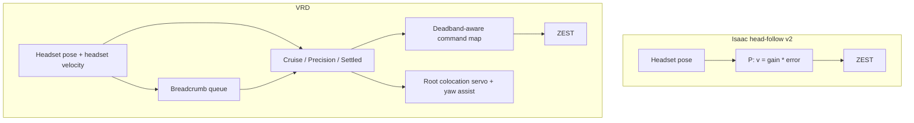

# VRD vs Isaac Head-Follow Locomotion — Plain-Language Explainer

This note clarifies how Vision Robot Demo (VRD / Vision Pro MuJoCo app) drives walking, how that differs from our Isaac head-follow stack (`sberchel_record_demos_v2.py` + `sberchel_head_follow_v2.py`), and what jargon like “feed-forward” and “breadcrumbs” actually mean.

**Focus: locomotion only** (not hand retargeting / fake teleop arms).

---

## 0. One-sentence answer

Both sides use the **same ZEST RL policy** to move the legs. VRD feels faster because it has a **much smarter outer controller** that *computes the velocity command* fed into ZEST, plus a few **kinematic cheats** that move the floating base a little without waiting for the gait. It is **not** a different neural network for walking.

---

## 1. Two layers (this is the whole mental model)

Think of walking as two stacked boxes:

```text
┌─────────────────────────────────────────────────────────┐
│  OUTER LOOP (hand-written control code)                 │
│  Input:  headset pose (and optionally headset speed)    │
│  Output: velocity command (vx, vy, wz)                  │
│  VRD: breadcrumbs + FF + stages + deadband mapping      │
│  Ours: P-controller on position/yaw error               │
└───────────────────────┬─────────────────────────────────┘
                        │  (vx, vy, wz) every policy step
                        ▼
┌─────────────────────────────────────────────────────────┐
│  INNER LOOP = ZEST policy (same ONNX family)            │
│  Input:  robot state + velocity command                 │
│  Output: leg (and in VRD, body) joint targets           │
│  Job: balance + gait that roughly tracks the command    │
└─────────────────────────────────────────────────────────┘
```

| Layer | What it is | Neural net? |
|-------|------------|-------------|
| Outer loop | Ordinary if/else + math (P-control, path following, …) | **No** |
| ZEST | Trained locomotion policy | **Yes** |
| VRD “colocation servo” / “yaw assist” | Directly edits MuJoCo root `qpos` a few cm / deg | **No** (kinematic cheat) |

So: **yes, VRD uses more than “just ZEST”** — but the extra pieces are **classic control + teleport assists**, not another walking NN.

### Same policy checkpoint

| | VRD | Our Isaac scripts |
|--|-----|-------------------|
| Policy | ZEST Core ML from `body_latest.onnx` | `Network(..., type="zest")` → same run folder |
| Run name | `no_dwell_walk_manip_data_vel_med_sigma_angmom_pen_symm` | same (`green_challenge` mapping `"zest"` → that folder) |
| How command enters | observation slot `locomotionCommand[3]` | `net.set_command_detailed(vx, vy, wz)` |

---

## 2. What *we* do (Isaac head-follow v2)

Every step roughly:

1. Read filtered headset world XY and view yaw.
2. Compute error vs robot root:
   - `err = headset_xy − robot_xy` (rotated into body frame → `err_bx`, `err_by`)
   - `err_yaw = headset_yaw − robot_yaw`
3. **P-controller** (proportional only):

```text
vx = clip(lin_gain * err_bx, max_lin)     # default gain 1.5, max 0.8 m/s
vy = clip(lin_gain * err_by, max_lin)
wz = clip(ang_gain * err_yaw, max_ang)    # default gain 2.5, max 1.5
```

4. Pass `(vx, vy, wz)` into ZEST.
5. Modes: **Standing** (station-keep near latch) vs **Pursuing** (chase headset). Upper body freezes while pursuing.

There is **no** estimate of how fast the user is walking. The robot only reacts to “how far away is the headset right now.”

### Why that lags while the user walks

Classic pursuit lag for a pure P-controller tracking a moving target:

```text
steady-state lag ≈ user_speed / lin_gain
```

Example: user walks at 0.6 m/s, gain = 1.5 → lag ≈ **0.4 m**. The robot forever trails behind even if ZEST tracks the command perfectly. That is the main “slow / inconvenient” feel vs VRD, before any other differences.

Code reference: `pursuing_command()` in `dsynth_isaac/teleop/sberchel_head_follow_v2.py`.

---

## 3. “Feed-forward” — not a neural network

### What people often hear

“FF” / “feed-forward network” → multilayer perceptron. **That is not what VRD means here.**

### What control engineers mean

**Feedback:** use the *error* (where you are vs where you want to be) to correct.  
**Feed-forward:** also command based on a *known disturbance / desired motion*, without waiting for error to grow.

VRD’s cruise formula (live goal, no breadcrumbs) is literally:

```text
desired_world_velocity =
      followGain * (headset_xy − robot_xy)     # feedback (P term), gain ≈ 0.42
    + 0.85 * headset_planar_velocity           # feed-forward
```

- `headset_planar_velocity` = how fast the headset is already moving on the floor (finite difference / smoothing over recent HMD samples).
- Multiplying by **0.85** means: “if the user is walking forward at 0.7 m/s, tell ZEST to walk forward at ~0.6 m/s *even when error is still small*.”

### “Residual FF error”

Bad phrasing on my part earlier. Meant:

> Once you feed-forward most of the user’s speed, the leftover tracking lag is only from the *imperfect* feed-forward gain (e.g. 0.85 instead of 1.0) plus ZEST not perfectly achieving the command — **not** a “residual feed-forward network.”

Compare:

| Controller | Rough lag while user walks at speed `v` |
|------------|------------------------------------------|
| Ours (P only) | ~ `v / lin_gain` (large) |
| VRD (P + 0.85·user_vel) | ~ `(1 − 0.85)·v` plus small P cleanup (much smaller) |

So “FF” = **copy the user’s walking velocity into the command**. No extra NN.

---

## 4. What “breadcrumbs” are

**Breadcrumbs = a short trail of waypoints dropped along the path the headset took.**

Not ML. Not a map of the warehouse. Just a queue in memory:

```text
User walks:   A ──► B ──► C ──► D (current headset)

VRD queue:    [A, B, C]   (D is the live goal when queue empties)

Robot does not aim only at D.
It pure-pursues along A→B→C at a fixed cruise speed (~0.7 m/s),
then finishes on the live headset pose.
```

### Why drop breadcrumbs?

If you only chase the *current* headset pose:

- User walks a curve → robot cuts corners poorly or oscillates.
- User gets far ahead → P-controller still only sees “big error,” but has no path.

If you record where the headset *was*:

- Robot can follow the user’s route (smoother corners via lookahead).
- Constant **cruise speed** while replaying the path → feels brisk and predictable.
- Loop-closure shortcut: if the user walks back near an older waypoint, drop the redundant middle of the queue (don’t force the robot to retrace a circle).

### Filters (so sway doesn’t spam waypoints)

A breadcrumb is enqueued only if roughly:

- headset planar speed ≳ 0.15 m/s (ignore weight-shift / looking around), and  
- spacing ≳ 0.22 m from the last breadcrumb.

Yaw-only head turns do **not** create breadcrumbs; orientation is handled by live yaw / precision stage.

### Pure-pursuit (related term)

Instead of always aiming at the *oldest* waypoint, aim at a point **~0.45 m ahead along the polyline**. Same idea as car path-following: smoother turns, less stop-and-go when a waypoint is “captured.”

---

## 5. VRD outer-loop stages (still not another policy)

When the breadcrumb queue is empty, VRD uses a small state machine on top of ZEST:

| Stage | Command to ZEST | Intent |
|-------|-----------------|--------|
| **Cruise** | FF + P toward live headset; often face the error heading | Catch up / walk with user |
| **Precision** | Turn-then-walk creep; command floored above ZEST deadband | Close last ~0.5 m without stalling |
| **Settled** | Exact `(0,0,0)` | Stop the gait; hand residual to kinematic servo |

Hysteresis + **dwell** (~0.45 s) stop the robot from limit-cycling (start walking → overshoot → stop → start again) around a standing user.

Our v2 analogue is coarser: **Standing vs Pursuing**, still pure P into ZEST, no precision floor / path / FF.

---

## 6. Extra lower-level pieces that are *not* ZEST

These are why people say VRD “teleports on small distances.” They run **inside the MuJoCo bridge**, editing the floating-base pose directly when it is safe.

### 6.1 Colocation servo (standstill root nudge)

When:

- velocity command ≈ 0, and  
- robot root speed is already low, and  
- a colocation target (headset planar pose) is published,

then each physics step **slides / rotates `qpos` root** toward the target at a capped rate (e.g. ~3 cm/s position, faster “snap” when user is clearly standing to manipulate).

That finishes the last centimeters that ZEST **cannot** place accurately. It is a kinematic assist, not walking.

### 6.2 Yaw assist (power steering while turning in place)

ZEST in-place yaw is slow and has a deadband. While an in-place yaw command is active and position is already close, VRD **adds extra root yaw** toward the target (up to ~0.55 rad/s) on top of the gait. Legs still step; heading catches up faster.

### 6.3 What we do not have

Isaac PhysX + our scripts do **not** kinematic-slide the root toward the headset. Residual XY/yaw must be closed by ZEST alone (or left inside deadzones). That alone makes “final alignment” feel stickier.

---

## 7. Policy deadbands (why “command 0.1 m/s” can mean “do nothing”)

VRD measured ZEST command → achieved velocity (same `vel_med` policy):

| Command axis | Rough behavior |
|--------------|----------------|
| Forward | Dead below ~0.17; above that achieved ≈ `1.26·cmd + 0.09` |
| Backward | Needs larger |cmd|; weaker tracking |
| Lateral (`vy`) | Effectively **dead** (~0 at cmd 0.26) |
| Yaw | Soft deadband ~0.15; achieved ≈ `0.60·(|cmd| − 0.15)` |

So VRD:

1. Works in **desired physical** m/s / rad/s in the outer loop.  
2. **Inverts** those curves before sending units into ZEST (or sends exact 0).  
3. Avoids mid-deadband commands that look like “robot parked with 30 cm error.”  
4. Does **not** rely on strafe: closes lateral error by facing the target and walking forward/back.

We send P-controller outputs straight into `set_command_detailed` as if command units were achieved velocity. Small `vx`/`wz` near the deadband may produce little motion; `vy` is largely wasted effort.

---

## 8. Side-by-side



| Topic | Isaac (us) | VRD |
|-------|------------|-----|
| Walking NN | ZEST `vel_med` | Same ZEST |
| Outer loop | P on pose error | Breadcrumbs + pure-pursuit + P + **velocity feed-forward** + stages |
| Uses headset *speed*? | No | Yes (FF term 0.85) |
| Path memory | No | Yes (breadcrumb queue) |
| Lateral strategy | Command `vy` | Mostly turn-then-walk |
| Final cm alignment | Policy / deadzone only | Zero cmd + **kinematic root servo** |
| In-place yaw boost | No | Yes (yaw assist) |
| Fake teleop hands | No (real Pink IK arms) | Yes (separate topic; not locomotion) |

---

## 9. Glossary

| Term | Meaning here |
|------|----------------|
| **ZEST** | The RL locomotion policy (ONNX / Core ML). Inner loop. |
| **Outer loop** | Code that chooses `(vx, vy, wz)` from headset tracking. |
| **P-controller / feedback** | `command ∝ error`. Reacts after lag appears. |
| **Feed-forward (FF)** | Add `k * user_velocity` to the command. **Not** a feed-forward neural net. |
| **Residual (tracking) lag** | Distance the robot still trails the user after the controller settles. |
| **Breadcrumb** | Waypoint saved along the headset path for later pursuit. |
| **Pure-pursuit** | Aim at a lookahead point on that path, not only the oldest waypoint. |
| **Colocation servo** | Kinematic nudge of the floating base toward the headset while standing. |
| **Yaw assist** | Extra kinematic yaw while ZEST turns in place. |
| **Deadband** | Command region where ZEST barely moves; must jump over or command exact 0. |
| **Policy command units** | Numbers in the observation command slots; related to but not identical to achieved m/s. |

---

## 10. Practical takeaway for our stack

To get closer to VRD *feel* without copying visionOS code:

1. **Add headset-velocity feed-forward** to `pursuing_command` (largest bang for lag).  
2. **Stop relying on `vy`**; prefer face-error-then-walk (or accept slow lateral).  
3. **Floor small non-zero commands** past ZEST’s deadband, or zero them and accept residual.  
4. Optionally: **breadcrumb / cruise** for long walks; **kinematic root nudge** when “arrived” (Isaac-equivalent of colocation servo — needs care with PhysX / contacts).

None of that replaces ZEST; it only changes what you ask ZEST to do, and optionally cheats the last centimeters the policy cannot finish.

### Implemented in v3 (no teleport)

Items 1–4 (except kinematic root nudge) are implemented as:

| Piece | Path |
|-------|------|
| Outer loop | [`dsynth_isaac/teleop/sberchel_head_follow_v3.py`](../dsynth_isaac/teleop/sberchel_head_follow_v3.py) |
| Record script | [`scripts/sberchel_record_demos_v3.py`](../scripts/sberchel_record_demos_v3.py) |

**Locked product choices:**

- **1B — unified stages:** `cruise` / `precision` / `settled` gate **both** legs and upper body. Live XR teleop only in `settled`. During `cruise`/`precision`, wrists are pelvis-relative frozen and **fingers keep the last teleop command** (carry-safe), via `capture_frozen_upper(..., last_teleop_upper)`.
- **2C — settled without teleport:** exact `(0,0,0)` inside the tight band; **soft station-keep P** into ZEST toward the live headset if residual sits outside a looser band. No PhysX root slide / yaw-assist.
- Same ZEST `Network(..., type="zest", closed_kinematics=False)` as v2.

v1/v2 scripts remain unchanged for comparison.

---

## 11. Source pointers (VRD zip)

| Concept | Where in VRD |
|---------|----------------|
| ZEST package / convert | `README.md`, `tools/convert_zest_onnx_to_coreml.py` |
| Breadcrumbs, FF, stages, deadband map | `TeleoperationSessionModel.swift` (`advanceLocomotion`, constants at top) |
| Policy cadence 50 Hz | `PolicyCadenceGate.swift` |
| Colocation servo + yaw assist | `MuJoCoBridge.mm` (`VRDApplyColocationServo`, `VRDApplyYawAssist`) |
| Measured tracking envelope | `LocomotionPolicyCharacterizationTests.mm` |
| Servo unit tests | `LocomotionColocationServoTests.mm` |

Our side: `sberchel_head_follow_v2.py` / `sberchel_record_demos_v2.py` (P-only Standing/Pursuing); `sberchel_head_follow_v3.py` / `sberchel_record_demos_v3.py` (VRD-style outer loop); related notes in `docs/sberchel_head_follow_teleop_report.md`.
